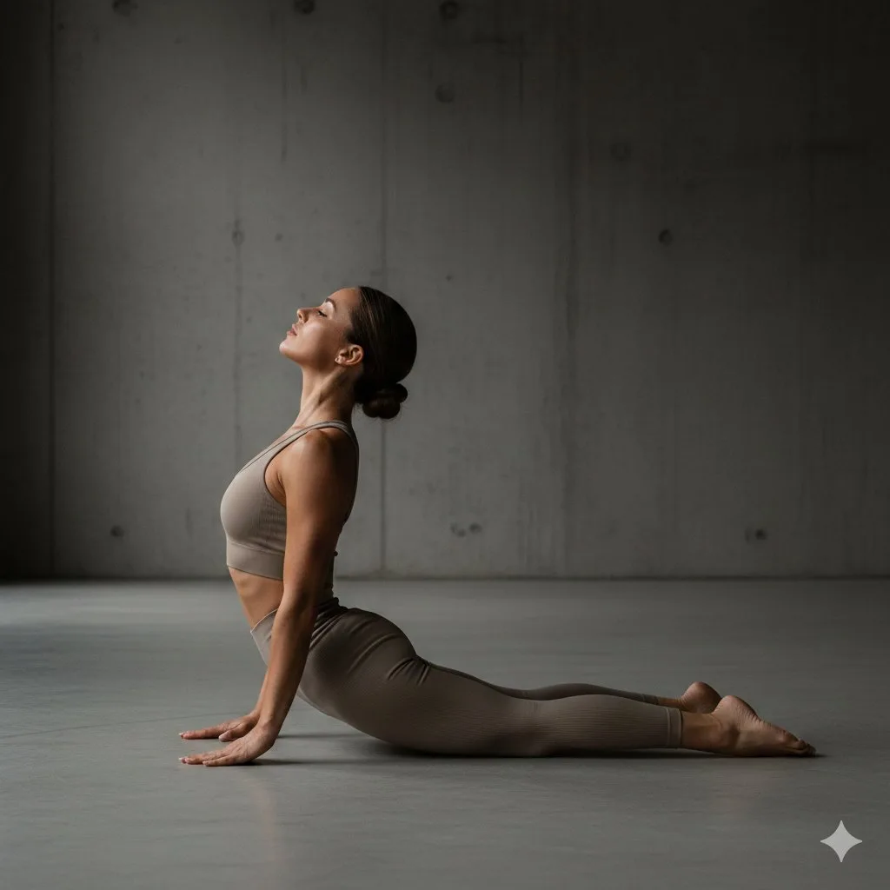

# Cuties — by @cuties7377

[← Back to Community Examples](../../EXAMPLES.md) · Category: Photography · Model: `Nano Banana`

<a href="https://x.com/cuties7377/status/2009861254341333164"></a>

Source: **[@cuties7377 on X](https://x.com/cuties7377/status/2009861254341333164)** · Creator: [Cuties](https://x.com/cuties7377)

## Prompt

```text
{
  "image_type":
 "athletic flex pose editorial photography",
  "visual_style": 
"high-end fitness editorial, cinematic, premium",
  "composition": {
    "framing":
 "full body, powerful stance emphasizing muscle definition",
    "camera_angle": 
"slightly low angle to enhance strength and dominance",
    "perspective": 
"cinematic perspective with strong body presence"
  },
  "subject": {
    "description": 
"athletic feminine body performing a controlled flex pose",
    "pose": 
"strong flex pose with engaged core, defined arms and legs, balanced posture",
    "body_language":
 "confident, controlled, disciplined strength",
    "expression": 
"calm, focused, effortless power"
  },
  "facial_details": {
    "emotion": "self-control, confidence",
    "micro_details": "relaxed jaw, steady eyes, natural intensity"
  },
  "wardrobe": {
    "clothing": "minimal athletic wear highlighting muscle lines",
    "textures": "matte, stretch performance fabric",
    "color_tones": "neutral, muted, dark or earthy tones"
  },
  "environment": {
    "location": "minimal indoor studio or clean gym space",
    "background": "plain, distraction-free, editorial backdrop",
    "atmosphere": "focused, intense, professional"
  },
  "lighting": {
    "type": "cinematic studio lighting",
    "quality": "high contrast with soft falloff",
    "direction": "side and rim lighting to sculpt muscles"
  },
  "color_palette": {
    "primary": ["charcoal", "warm beige", "muted skin tones"],
    "mood": "powerful, disciplined, modern"
  },
  "camera_details": {
    "lens": "35mm–50mm cinematic look",
    "focus": "sharp focus on body definition",
    "realism": "ultra-realistic, editorial quality"
  },
  "overall_mood": "quiet power, control, strength without aggression",
  "intended_use": "viral flex pose post on X (Twitter), fitness branding, editorial content"
}
```

## Try it

Paste the prompt into **[vinano.ai](https://vinano.ai?utm_source=github&utm_medium=readme&utm_campaign=awesome-image-video-prompts-updating&utm_content=x-page-try)** to generate your own version.

> The image and prompt belong to @cuties7377 ([original post](https://x.com/cuties7377/status/2009861254341333164)) and are shown here with credit for reference. Creators can ask for changes or removal by opening an issue.
