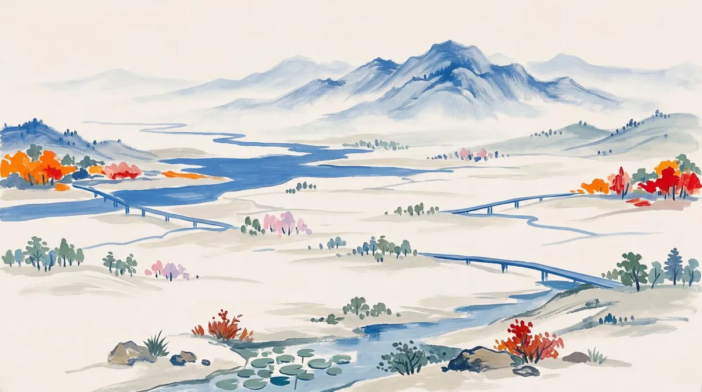

# Zayn Hao — by @ZaynHao

[← Back to Examples from X](../../EXAMPLES.md) · Category: Illustration & 3D · Model: `Nano Banana`

<a href="https://x.com/ZaynHao/status/2034103289185505560"></a>

Original post: **[@ZaynHao on X](https://x.com/ZaynHao/status/2034103289185505560)** · Creator: [Zayn Hao](https://x.com/ZaynHao)

## Prompt

```text
使用以 #f6f4f0 为主背景，#2d6dc3 为主蓝色，同时也包含一些橙色元素，制作了一张山水远景风景画。
```

## Try it

Paste the prompt into **[vinano.ai](https://vinano.ai?utm_source=github&utm_medium=readme&utm_campaign=awesome-image-video-prompts-updating&utm_content=x-page-try)** to generate your own version.

> The image and prompt belong to [@ZaynHao](https://x.com/ZaynHao) and are shown here with credit for reference. Creators can ask for changes or removal by opening an issue.
