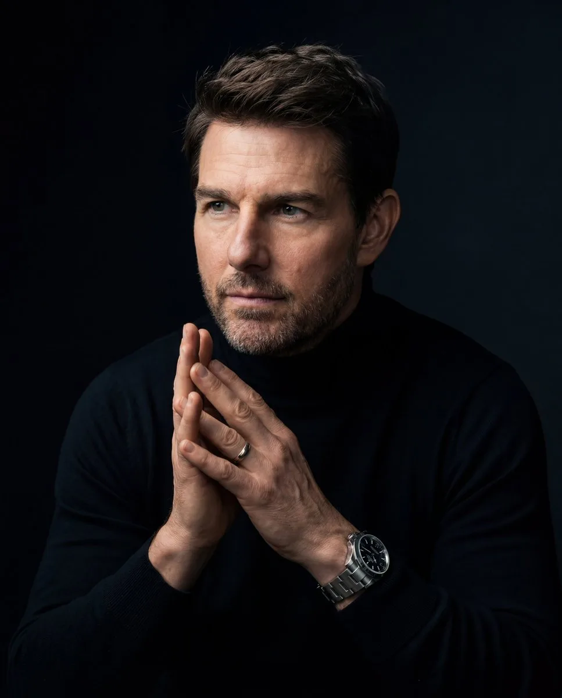

# Heisenberg — by @rovvmut_

[← Back to Examples from X](../../EXAMPLES.md) · Category: Photography · Model: `Nano Banana`

<a href="https://x.com/rovvmut_/status/2042467417990017141"></a>

Original post: **[@rovvmut_ on X](https://x.com/rovvmut_/status/2042467417990017141)** · Creator: [Heisenberg](https://x.com/rovvmut_)

## Prompt

```text
A hyper-realistic cinematic portrait of a man with short, textured hair and a well-groomed stubble beard, captured in a dark, moody 'night mode' aesthetic. The man is sitting in a contemplative pose, hands clasped together near his chest, fingers interlaced, with his gaze directed thoughtfully off-camera to the left. He is wearing a premium black high-neck turtleneck sweater and a silver-link luxury wristwatch on his left wrist, with a simple band on his right ring finger. The lighting is dramatic and controlled: a soft rim light outlines his silhouette against an almost pitch-black, shadow-drenched background, while a subtle, soft key light illuminates his face and hands. Shallow depth of field, 85mm portrait lens, ultra-sharp focus on the man's expression and clasped hands, with the chair in the background heavily blurred into complete darkness. Minimalist, professional, editorial photography, 4:5 aspect ratio, clean composition focusing strictly on the upper torso and face.
```

## Try it

Paste the prompt into **[vinano.ai](https://vinano.ai?utm_source=github&utm_medium=readme&utm_campaign=awesome-image-video-prompts-updating&utm_content=x-page-try)** to generate your own version.

> The image and prompt belong to [@rovvmut_](https://x.com/rovvmut_) and are shown here with credit for reference. Creators can ask for changes or removal by opening an issue.
