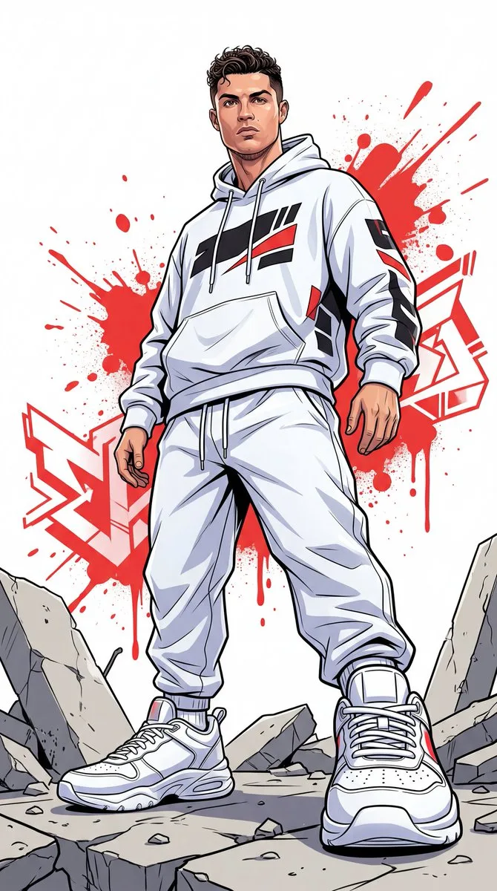

# Saul Goodman — by @Goodmanprotocol

[← Back to Community Examples](../../EXAMPLES.md) · Category: Illustration & 3D · Model: `Nano Banana`

<a href="https://x.com/Goodmanprotocol/status/2042609010659201189"></a>

Source: **[@Goodmanprotocol on X](https://x.com/Goodmanprotocol/status/2042609010659201189)** · Creator: [Saul Goodman](https://x.com/Goodmanprotocol)

## Prompt

```text
A dynamic full-body urban illustration of a man (use the exact face from the provided reference image, ensuring high facial accuracy and identity preservation). He wears an oversized white hoodie with subtle black and red accents, paired with loose white track pants and bold, eye-catching white sneakers.
The character has a sharp, confident gaze directed forward, conveying intensity and self-assurance. The composition is captured from a dramatic low-angle perspective, emphasizing power and dominance. His stance is strong and grounded, with exaggerated perspective on the sneakers in the foreground for added depth.
Surrounding him are fragmented concrete elements and subtle debris, suggesting an urban, gritty environment. The background is a clean white canvas featuring bold red paint splashes and abstract geometric shapes, creating a modern street-art aesthetic.
The visual style combines crisp, clean line art with vibrant flat colors and soft cel shading for depth and dimension. The rendering should feel like a high-end urban illustration or stylized editorial artwork.
Lighting is bright, even, and diffused across the entire scene, minimizing harsh shadows while maximizing clarity and detail.
Ultra-detailed, sharp focus, 8K resolution, vertical composition
```

## Try it

Paste the prompt into **[vinano.ai](https://vinano.ai?utm_source=github&utm_medium=readme&utm_campaign=awesome-image-video-prompts-updating&utm_content=x-page-try)** to generate your own version.

> The image and prompt belong to @Goodmanprotocol ([original post](https://x.com/Goodmanprotocol/status/2042609010659201189)) and are shown here with credit for reference. Creators can ask for changes or removal by opening an issue.
