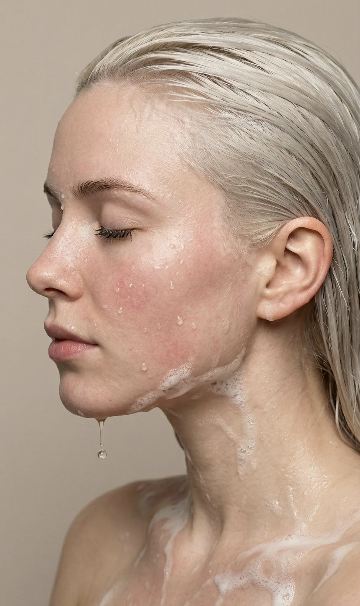

# Iris — by @xIrissy

[← Back to Examples from X](../../EXAMPLES.md) · Category: Photography · Model: `Nano Banana`

<a href="https://x.com/xIrissy/status/2009692941011571059"></a>

Original post: **[@xIrissy on X](https://x.com/xIrissy/status/2009692941011571059)** · Creator: [Iris](https://x.com/xIrissy)

## Prompt

```text
{
  "prompt_type": "Ultra Photorealistic Portrait",
  "subject": {
    "demographics": "Young woman",
    "perspective": "Side profile view (facing left)",
    "appearance": {
      "skin": {
        "texture": "Hyper-realistic, wet skin texture with visible pores, natural flushed redness on cheeks",
        "details": "Multiple clear water droplets clinging to the face, white soapy foam/suds along the jawline, neck, and collarbone",
        "wetness": "A single distinct water droplet dripping from the chin"
      },
      "hair": {
        "color": "Silver / Platinum Blonde",
        "style": "Slicked back, completely wet, strands defined by water",
        "texture": "Fine, straight"
      },
      "face": {
        "eyes": "Closed, relaxed eyelids",
        "brows": "Natural, unshaped",
        "lips": "Soft, natural pink, slightly parted",
        "expression": "Serene, calm, spa-like relaxation"
      }
    }
  },
  "pose": {
    "head_position": "Turned 90 degrees to the left showing full profile",
    "body": "Shoulders bare (suggesting nudity or strapless top), neck elongated",
    "action": "Standing or sitting still while bathing/washing face"
  },
  "styling": {
    "makeup": "No makeup / fresh face aesthetic",
    "elements": "White soap suds/foam running down the neck and chest",
    "vibe": "Clean beauty, skincare campaign, raw and organic"
  },
  "environment": {
    "setting": "Minimalist studio or bathroom setting",
    "background": "Solid neutral beige / tan color",
    "details": "Clean, uncluttered, focus entirely on the subject"
  },
  "lighting": {
    "type": "Soft diffused studio lighting",
    "quality": "Even illumination, soft highlights on the wet skin and water droplets",
    "shadows": "Gentle modeling shadows under the jaw and ear",
    "direction": "Side lighting accentuating the profile"
  },
  "camera_settings": {
    "shot_type": "Close-up portrait / Headshot",
    "lens": "85mm or 105mm Macro lens",
    "aperture": "f/2.8 to f/4.0 (keeping the face sharp while softening the hair slightly)",
    "focus": "Sharp focus on the eyelashes and water droplets on the cheek",
    "shutter_speed": "1/200s (to freeze the dripping water)"
  },
  "technical_details": {
    "resolution": "8k",
    "quality_tags": [
      "Ultra-detailed",
      "Macro photography",
      "Subsurface scattering",
      "Wet skin shader",
      "Ray tracing",
      "Unreal Engine 5 render style",
      "Raw photo quality"
    ],
    "mood": "Intimate, cleansing, peaceful, sensory"
  }
}
```

## Try it

Paste the prompt into **[vinano.ai](https://vinano.ai?utm_source=github&utm_medium=readme&utm_campaign=awesome-image-video-prompts-updating&utm_content=x-page-try)** to generate your own version.

> The image and prompt belong to [@xIrissy](https://x.com/xIrissy) and are shown here with credit for reference. Creators can ask for changes or removal by opening an issue.
