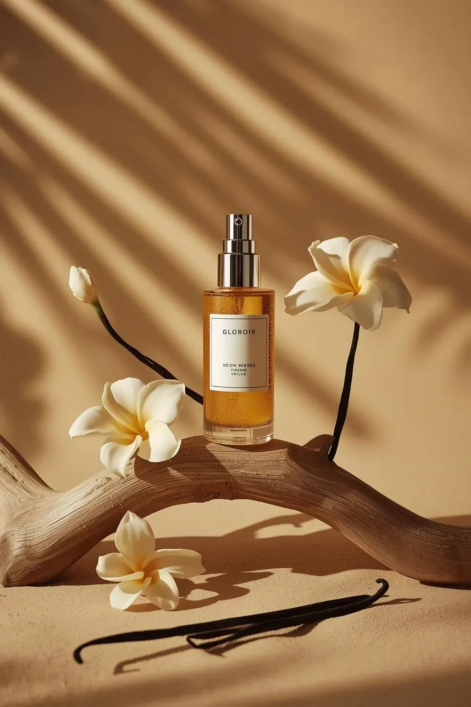

# Oogie — by @oggii_0

[← Back to Community Examples](../../EXAMPLES.md) · Category: Product & Brand · Model: `Nano Banana`

<a href="https://x.com/oggii_0/status/2010381168810799353"></a>

Source: **[@oggii_0 on X](https://x.com/oggii_0/status/2010381168810799353)** · Creator: [Oogie](https://x.com/oggii_0)

## Prompt

```text
- Ultra-cinematic luxury skincare product photography of a translucent amber serum pump bottle standing upright at the center of the frame, perched on a curved piece of textured driftwood, featuring a minimalist label with crisp black typography and fine condensation droplets on the glass; the bottle is framed by creamy white tropical flowers in full bloom and a single unopened bud, arranged symmetrically along the wood for sculptural balance, with slender vanilla pods resting in the foreground; background is a warm, desert-toned studio environment with sweeping shadow patterns cast across a soft sand-colored backdrop, creating a dramatic play of light and depth; lighting is high-contrast cinematic lighting with a strong directional key light from the left producing glowing highlights through the amber liquid, sharp rim lighting along the glass edges, and deep shadow falloff for a moody, editorial look;

color palette is rich and sensual with golden ambers, warm caramel, soft ivory, and deep earthy browns; composition is a centered hero shot with a slight low-angle perspective and shallow depth of field, keeping the bottle razor-sharp while background elements dissolve into creamy bokeh; mood is elegant, mysterious, and high-fashion, evoking premium fragrance-inspired skincare advertising with hyper-realistic textures, dramatic contrast, cinematic atmosphere, and 8K

ultra-high-definition realism.
```

## Try it

Paste the prompt into **[vinano.ai](https://vinano.ai?utm_source=github&utm_medium=readme&utm_campaign=awesome-image-video-prompts-updating&utm_content=x-page-try)** to generate your own version.

> The image and prompt belong to @oggii_0 ([original post](https://x.com/oggii_0/status/2010381168810799353)) and are shown here with credit for reference. Creators can ask for changes or removal by opening an issue.
