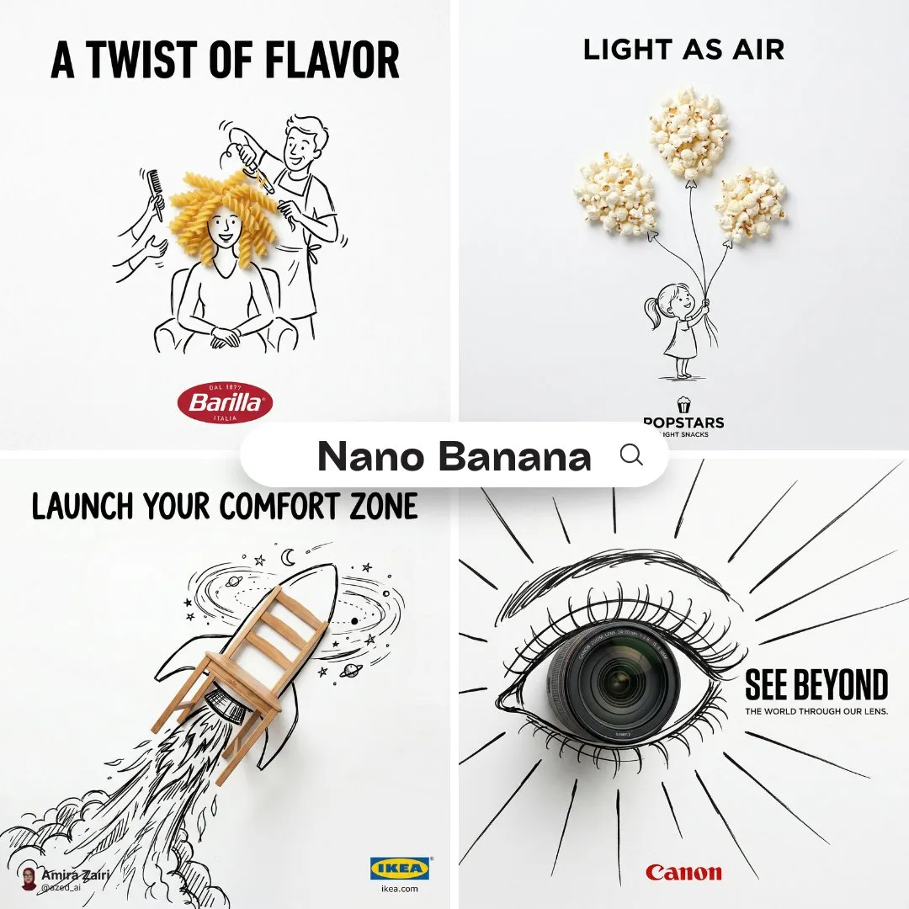

# Amira Zairi — by @azed_ai

[← Back to Community Examples](../../EXAMPLES.md) · Category: UI & Graphic · Model: `Nano Banana`

<a href="https://x.com/azed_ai/status/2032094792583430443"></a>

Source: **[@azed_ai on X](https://x.com/azed_ai/status/2032094792583430443)** · Creator: [Amira Zairi](https://x.com/azed_ai)

## Prompt

```text
A minimalist and creative advertisement set on a pure white background. A real photographic [Real Object] is integrated into a simple hand-drawn black ink doodle using loose, playful lines. The [Doodle Concept] interacts directly and cleverly with the real object, making the object part of the illustrated scene. Include bold uppercase black “[Ad Copy]” text at the top. Place the official [Brand Logo] clearly centered at the bottom. Clean layout, high contrast between realistic object and flat doodle drawing, lots of negative space, smart visual metaphor, print-ready poster design
```

## Try it

Paste the prompt into **[vinano.ai](https://vinano.ai?utm_source=github&utm_medium=readme&utm_campaign=awesome-image-video-prompts-updating&utm_content=x-page-try)** to generate your own version.

> The image and prompt belong to @azed_ai ([original post](https://x.com/azed_ai/status/2032094792583430443)) and are shown here with credit for reference. Creators can ask for changes or removal by opening an issue.
