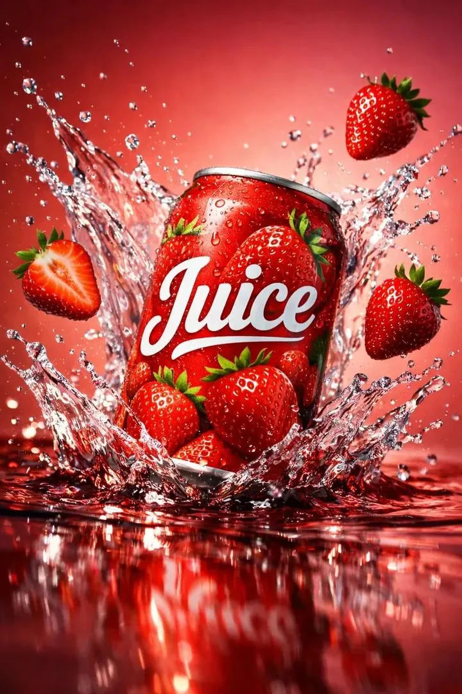

# 𝐌 — by @Strength04_X

[← Back to Community Examples](../../EXAMPLES.md) · Category: Food & Drink · Model: `Nano Banana`

<a href="https://x.com/Strength04_X/status/2009118898864771537"></a>

Source: **[@Strength04_X on X](https://x.com/Strength04_X/status/2009118898864771537)** · Creator: [𝐌](https://x.com/Strength04_X)

## Prompt

```text
Ultra-realistic cinematic beverage product photography of a vibrant red aluminum juice can captured from a dramatic top-down three-quarter angle, the can lying diagonally on its side as if just knocked over, with the opening facing toward the camera and a burst of clear liquid splashing outward in a sweeping arc across the frame; the can features bold white “Juice” typography and strawberry illustrations, partially wet with condensation and splash residue; glossy liquid spreads across a reflective surface below, forming dynamic ripples and elongated reflections that lead the eye through the composition; fresh ripe strawberries—whole, sliced, and halved—are scattered asymmetrically around the can, some resting in the liquid pool, others frozen mid-air as if tossed, with varying scale and depth for cinematic layering; background is a smooth coral-to-rose gradient studio backdrop viewed at an angle, enhancing depth and motion; lighting is dramatic cinematic lighting with a strong side key light creating sharp highlights on the can rim and liquid splash, rim lighting separating strawberries from the background, and deep soft shadows adding contrast and mood; color palette is bold and saturated with strawberry red, crimson liquid, fresh green leaves, and warm pink tones; composition is dynamic and off-center with diagonal energy, shallow depth of field isolating the can while foreground splashes remain crisp and background elements softly fall off; mood is energetic, high-impact, and cinematic, evoking premium blockbuster-style beverage advertising with hyper-realistic fluid dynamics, ultra-detailed textures, dramatic contrast, and 8K ultra-high-definition realism.
```

## Try it

Paste the prompt into **[vinano.ai](https://vinano.ai?utm_source=github&utm_medium=readme&utm_campaign=awesome-image-video-prompts-updating&utm_content=x-page-try)** to generate your own version.

> The image and prompt belong to @Strength04_X ([original post](https://x.com/Strength04_X/status/2009118898864771537)) and are shown here with credit for reference. Creators can ask for changes or removal by opening an issue.
