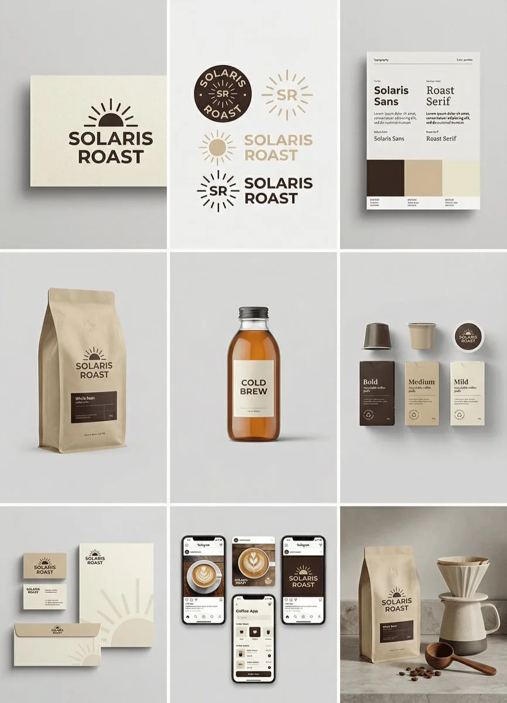

# Amira Zairi — by @azed_ai

[← Back to Examples from X](../../EXAMPLES.md) · Category: Product & Brand · Model: `Nano Banana`

<a href="https://x.com/azed_ai/status/2016511852927438909"></a>

Original post: **[@azed_ai on X](https://x.com/azed_ai/status/2016511852927438909)** · Creator: [Amira Zairi](https://x.com/azed_ai)

## Prompt

```text
[brand name], complete brand identity grid, 3x3 layout, nine tiles showing a full cohesive brand system, light gray seamless background, soft diffused studio lighting, subtle shadows, clean modern minimal style, consistent color palette of [color1] [color2] [color3], high-end studio mockups, ultra-realistic, 8k, 1:1,

tile 1 primary logo lockup on paper card,
tile 2 secondary logo mark and monogram variations,
tile 3 color palette swatches and typography specimen poster,
tile 4 packaging mockup for [product 1],
tile 5 hero product photo for [product 2],
tile 6 set of three products for [product 3] in different sizes,
tile 7 stationery mockups business card letterhead envelope,
tile 8 social media post mockups and phone screen UI preview,
tile 9 lifestyle scene featuring [product 1] with props matching the brand,

no people, no readable real-world brand names, no watermark.
```

## Try it

Paste the prompt into **[vinano.ai](https://vinano.ai?utm_source=github&utm_medium=readme&utm_campaign=awesome-image-video-prompts-updating&utm_content=x-page-try)** to generate your own version.

> The image and prompt belong to [@azed_ai](https://x.com/azed_ai) and are shown here with credit for reference. Creators can ask for changes or removal by opening an issue.
