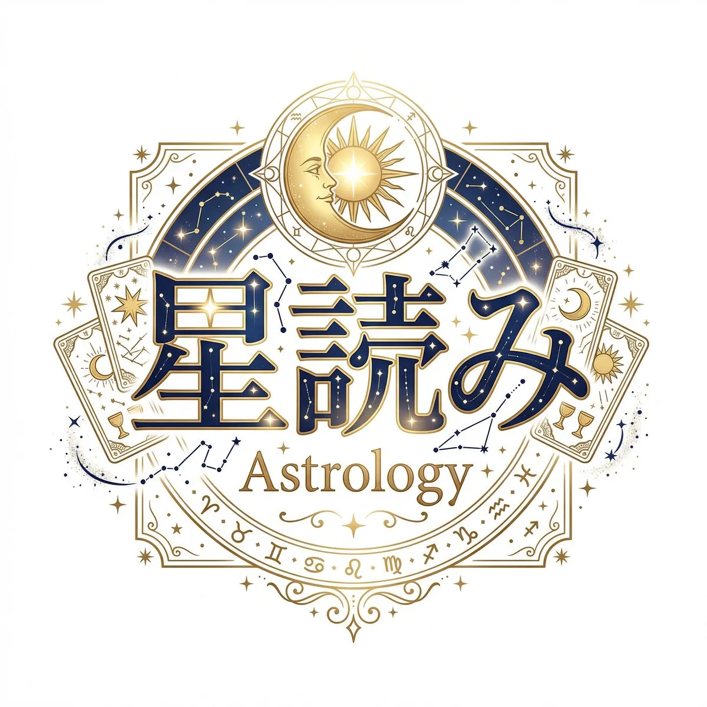

# みどり🐲Midori Tatsuta — by @midori_tatsuta

[← Back to Community Examples](../../EXAMPLES.md) · Category: UI & Graphic · Model: `Nano Banana`

<a href="https://x.com/midori_tatsuta/status/2039682237751509053"></a>

Source: **[@midori_tatsuta on X](https://x.com/midori_tatsuta/status/2039682237751509053)** · Creator: [みどり🐲Midori Tatsuta](https://x.com/midori_tatsuta)

## Prompt

```text
style_preset: "Zodiac Astrology VTuber Logo Aesthetics (Celestial Ver.)"
global_settings:
  vibe: "Mystical, celestial, cosmic wisdom, divination, stargazing"
  background: "Pure white background (for isolation)"
  rendering:
    - "Elegant, celestial vector-style finish"
    - "Deep midnight blue and shining gold palette"
    - "Thin elegant layered outlines with star accents"
    - "Glowing star effects and celestial glow"
drawing_rules:
  line_quality: "Thin, elegant curves with constellation line art accents."
  character_design:
    - "Integrated constellation and tarot motifs woven into the letters"
    - "Custom stylized font: elegant, celestial shapes with star dot accents"
  typography_style:
    - "Main Title: Large, stylized Japanese with constellation dot patterns"
    - "Subtitle: Smaller English text in an elegant celestial font"
  ornament_rule:
    - "Strictly follow the 'ornaments_selection' provided in the USER INPUT SECTION"
    - "Distribute ornaments to create a 'celestial reading' visual impact"
visual_parameters:
  color_palette:
    primary: "Deep midnight blue and shining gold gradient"
    secondary: "Thin gold inner border + Midnight blue outer stroke"
    accents: "Constellation lines, zodiac symbols, and star glow"

# ----------------------------------------------------------
# USER INPUT SECTION (下記を自由に編集してね)
# ----------------------------------------------------------
request:
  input_text: "星読み" # ← ここを好きな名前に変更
  subtitle: "Astrology" # ← 小さく表示したい文字
  motif_concept: "星座図とタロットカード" # ← ここを好きな動物やモノに変更

  custom_colors: "ミッドナイトブルーとシャイニングゴールド" # ← 好きな色を指定

  ornaments_selection:
    - "星座線 (Zodiac constellation lines)"
    - "タロットカード (Tarot card borders)"
    - "三日月 (Crescent moon)"
    - "太陽 (Radiant sun)"
    - "魔法陣 (Mystical magic circle)"
```

## Try it

Paste the prompt into **[vinano.ai](https://vinano.ai?utm_source=github&utm_medium=readme&utm_campaign=awesome-image-video-prompts-updating&utm_content=x-page-try)** to generate your own version.

> The image and prompt belong to @midori_tatsuta ([original post](https://x.com/midori_tatsuta/status/2039682237751509053)) and are shown here with credit for reference. Creators can ask for changes or removal by opening an issue.
