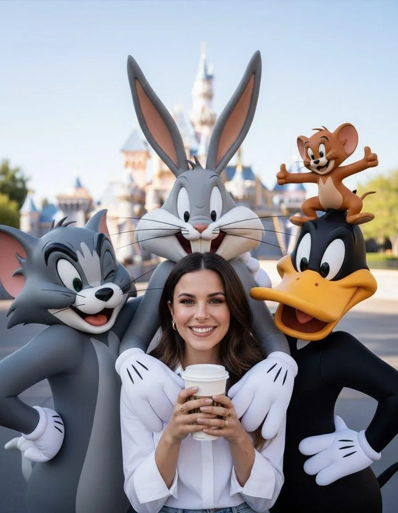

# Taaruk — by @Taaruk_

[← Back to Examples from X](../../EXAMPLES.md) · Category: Photography · Model: `Nano Banana`

<a href="https://x.com/Taaruk_/status/2009462964206882926"></a>

Original post: **[@Taaruk_ on X](https://x.com/Taaruk_/status/2009462964206882926)** · Creator: [Taaruk](https://x.com/Taaruk_)

## Prompt

```text
{
  "Objective": "Create a cheerful lifestyle portrait set in a magical theme park with joyful mascot characters",
  "PersonaDetails": {
    "PrimarySubject": {
      "Type": "Young woman",
      "Pose": "Standing relaxed, holding a takeaway coffee cup with both hands",
      "Expression": "Warm smile, cheerful and relaxed",
      "Style": "Casual lifestyle look"
    },
    "MascotCharacters": [
      {
        "Type": "Tall grey rabbit mascot",
        "Interaction": "Hugging the woman from behind",
        "Emotion": "Joyful, playful"
      },
      {
        "Type": "Grey cat mascot",
        "Position": "Standing at her side",
        "Emotion": "Friendly, happy"
      },
      {
        "Type": "Black duck mascot",
        "Position": "Standing on the opposite side",
        "Emotion": "Playful and welcoming"
      },
      {
        "Type": "Small brown mouse mascot",
        "Position": "Playfully posing above the group",
        "Emotion": "Energetic and mischievous"
      }
    ]
  },
  "SceneDescription": {
    "Location": "Famous theme park",
    "Background": {
      "Landmark": "Fairytale castle",
      "Treatment": "Softly blurred for depth"
    },
    "Environment": "Open plaza with a lively, family-friendly atmosphere"
  },
  "Composition": {
    "Framing": "Medium lifestyle portrait",
    "Grouping": "Centered subject surrounded by characters",
    "DepthOfField": "Shallow depth of field",
    "Focus": "Sharp focus on faces with softly blurred background"
  },
  "LightingAndColor": {
    "Lighting": "Bright natural daylight",
    "ColorPalette": "Vibrant, saturated yet balanced colors",
    "Highlights": "Soft, clean highlights enhancing cheerful mood"
  },
  "ArtDirection": {
    "Style": "High realism blended with animated character charm",
    "Aesthetic": "Playful, magical, family-friendly",
    "DetailLevel": "Ultra-detailed textures on clothing and mascot costumes"
  },
  "PhotographyStyle": {
    "Genre": "Theme park lifestyle photography",
    "CompositionStyle": "Cinematic yet candid",
    "ImageQuality": "High resolution, crisp detail"
  },
  "Mood": {
    "Tone": "Happy, welcoming, whimsical",
    "Energy": "Lighthearted, joyful, magical"
  },
  "NegativePrompt": [
    "dark mood",
    "empty background",
    "scary characters",
    "low resolution",
    "blurry faces",
    "harsh shadows",
    "desaturated colors"
  ],
  "ResponseFormat": {
    "Type": "Single image",
    "Orientation": "Portrait",
    "AspectRatio": "2:3"
  }
}
```

## Try it

Paste the prompt into **[vinano.ai](https://vinano.ai?utm_source=github&utm_medium=readme&utm_campaign=awesome-image-video-prompts-updating&utm_content=x-page-try)** to generate your own version.

> The image and prompt belong to [@Taaruk_](https://x.com/Taaruk_) and are shown here with credit for reference. Creators can ask for changes or removal by opening an issue.
