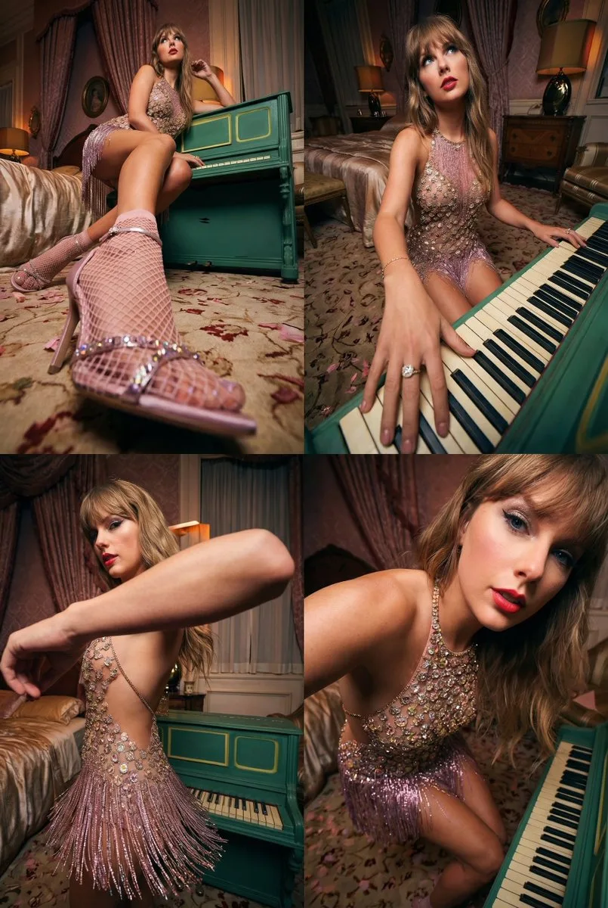

# ANKIT PATEL 🇮🇳 | AI — by @Ankit_patel211

[← Back to Examples from X](../../EXAMPLES.md) · Category: Photography · Model: `Nano Banana`

<a href="https://x.com/Ankit_patel211/status/2019833999154376925"></a>

Original post: **[@Ankit_patel211 on X](https://x.com/Ankit_patel211/status/2019833999154376925)** · Creator: [ANKIT PATEL 🇮🇳 | AI](https://x.com/Ankit_patel211)

## Prompt

```text
Transform the original photo into a dramatic, photorealistic, ultra-detailed set of 4 styles characters are included , each a mid close up wide-angle shot with an extreme, dynamic camera angle complex, powerful pose in a consistent, expanded version of the original environment, with cinematic lighting, high contrast, crisp textures, and precise color grading.
```

## Try it

Paste the prompt into **[vinano.ai](https://vinano.ai?utm_source=github&utm_medium=readme&utm_campaign=awesome-image-video-prompts-updating&utm_content=x-page-try)** to generate your own version.

> The image and prompt belong to [@Ankit_patel211](https://x.com/Ankit_patel211) and are shown here with credit for reference. Creators can ask for changes or removal by opening an issue.
