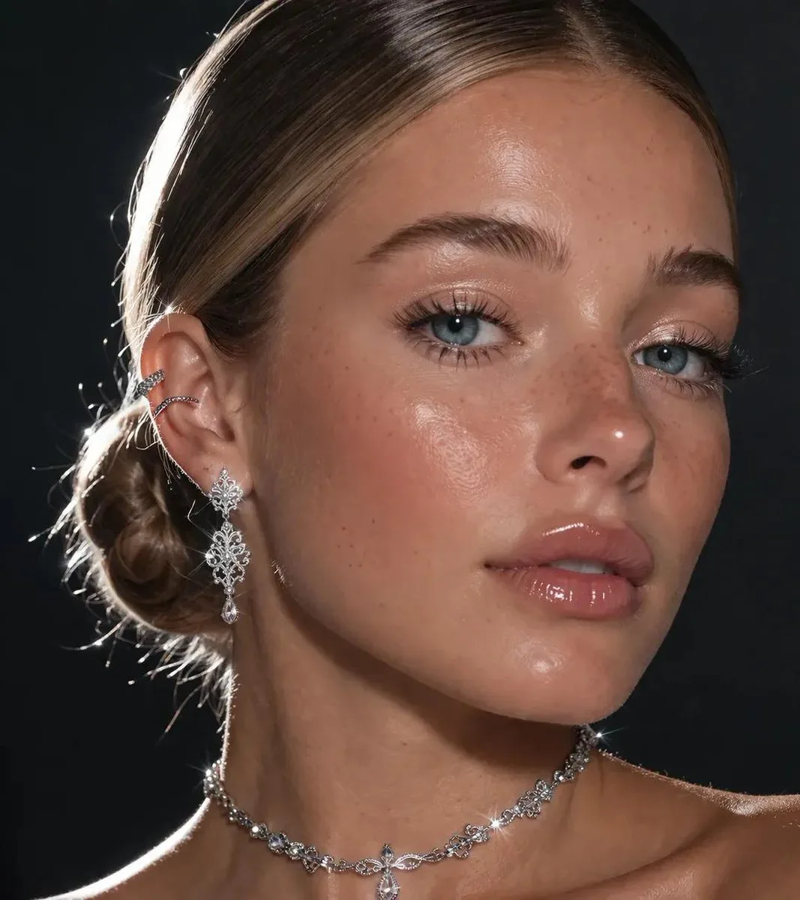

# Oogie — by @oggii_0

[← Back to Community Examples](../../EXAMPLES.md) · Category: Photography · Model: `Nano Banana`

<a href="https://x.com/oggii_0/status/2042586039450243514"></a>

Source: **[@oggii_0 on X](https://x.com/oggii_0/status/2042586039450243514)** · Creator: [Oogie](https://x.com/oggii_0)

## Prompt

```text
An extreme close-up focusing on a pretty lady's face and neck. She has blue eyes, she is wearing intricate silver jewelry and a sleek, middle-parted low bun with a high-shine finish. Her hair - dirty blonde hair, The makeup is "clean girl" aesthetic-dewy skin, clear gloss, and shimmering champagne eyeshadow. Dramatic rim lighting against a dark charcoal background, sharp focus on the jewelry reflections and individual hair edges.
```

## Try it

Paste the prompt into **[vinano.ai](https://vinano.ai?utm_source=github&utm_medium=readme&utm_campaign=awesome-image-video-prompts-updating&utm_content=x-page-try)** to generate your own version.

> The image and prompt belong to @oggii_0 ([original post](https://x.com/oggii_0/status/2042586039450243514)) and are shown here with credit for reference. Creators can ask for changes or removal by opening an issue.
