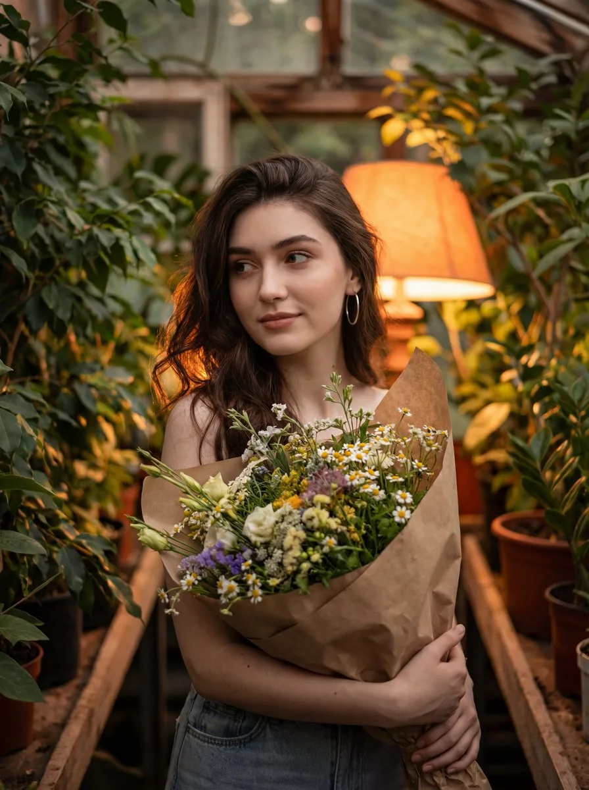

# Zara — by @ZaraIrahh

[← Back to Community Examples](../../EXAMPLES.md) · Category: Photography · Model: `Nano Banana`

<a href="https://x.com/ZaraIrahh/status/2011248143925723306"></a>

Source: **[@ZaraIrahh on X](https://x.com/ZaraIrahh/status/2011248143925723306)** · Creator: [Zara](https://x.com/ZaraIrahh)

## Prompt

```text
Use the uploaded image as a reference for the character. Create a sweet, cute, youthful-looking girl with a relaxed, languid posture and expressive emotions.
She is holding a large bouquet of flowers wrapped in kraft paper, She is surrounded by many green plants. The image should feel tactile, immersive, and atmospheric, with a sense of surreal sophistication and subtle motion blur. The girl has soft dark brown hair styled naturally, with an asymmetrical composition, glancing left and right,and her hairstyle should enhance the mood. Her makeup is sweet and natural, facial features delicate and realistic.
Lighting should be soft, warm and a lamp orange bulb behind her creates softly orange, with nuanced shadows, creating a warm light on her hair, head and on her face, comforting atmosphere. Clothing should feel casual and realistic, and her pose should be natural and coordinated, conveying a relaxed, comfortable lifestyle. She wears silver hoop earrings.
```

## Try it

Paste the prompt into **[vinano.ai](https://vinano.ai?utm_source=github&utm_medium=readme&utm_campaign=awesome-image-video-prompts-updating&utm_content=x-page-try)** to generate your own version.

> The image and prompt belong to @ZaraIrahh ([original post](https://x.com/ZaraIrahh/status/2011248143925723306)) and are shown here with credit for reference. Creators can ask for changes or removal by opening an issue.
