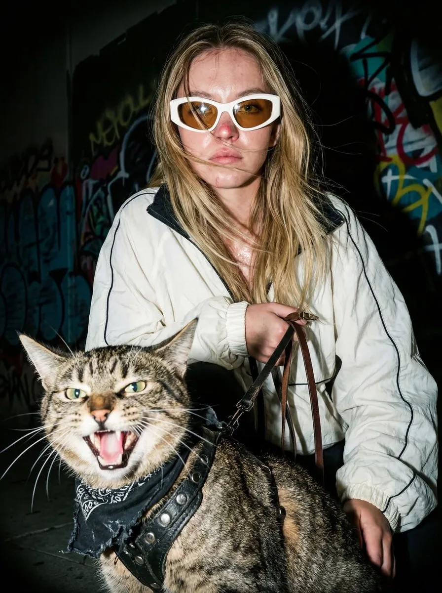

# Melisa♡ — by @xmliisu

[← Back to Examples from X](../../EXAMPLES.md) · Category: Photography · Model: `Nano Banana`

<a href="https://x.com/xmliisu/status/2018681442151084258"></a>

Original post: **[@xmliisu on X](https://x.com/xmliisu/status/2018681442151084258)** · Creator: [Melisa♡](https://x.com/xmliisu)

## Prompt

```text
{
  "image_prompt_data": {
    "subjects": {
      "human": {
        "appearance": "Young woman with long, tousled blonde hair falling over shoulders.",
        "facial_features": "Neutral to serious expression, visible rosy mark or redness on the bridge of the nose, glossy lips.",
        "pose": "Crouching or leaning forward, hand gripping a leather leash."
      },
      "animal": {
        "type": "Tabby cat (brown, black, and grey stripes).",
        "expression": "Mouth wide open in a hiss, meow, or yawn; visible teeth and tongue; intense and energetic expression.",
        "position": "Foreground, sitting or standing while leashed."
      }
    },
    "attire_and_accessories": {
      "human_clothing": "White nylon track jacket or windbreaker with black piping/stripes running down the sleeves; retro sporty aesthetic.",
      "eyewear": "Thick-framed white rectangular sunglasses with amber/orange tinted lenses.",
      "animal_gear": "Black leather harness adorned with metal studs, black paisley bandana around the neck.",
      "props": "Brown leather leash held taut."
    },
    "setting_and_background": {
      "location": "Urban exterior at night.",
      "background": "Dark wall covered in colorful, blurred graffiti tags (blue, yellow, red paint visible).",
      "atmosphere": "Gritty, underground, street-style vibe."
    },
    "lighting_and_style": {
      "lighting_technique": "Direct camera flash (flash photography), hard lighting with high contrast, bright foreground subjects against a dark background.",
      "visual_style": "Paparazzi style, candid, edgy fashion editorial, raw and realistic.",
      "color_palette": "High contrast; bright whites, deep blacks, amber tints, and muted graffiti colors."
    },
    "technical_specifications": {
      "quality": "4K, Ultra HD, photorealistic.",
      "details": "High resolution, sharp focus on the woman and cat, detailed texture on the cat's fur and the jacket fabric.",
      "aspect_ratio": "Portrait."
    }
  }
}
```

## Try it

Paste the prompt into **[vinano.ai](https://vinano.ai?utm_source=github&utm_medium=readme&utm_campaign=awesome-image-video-prompts-updating&utm_content=x-page-try)** to generate your own version.

> The image and prompt belong to [@xmliisu](https://x.com/xmliisu) and are shown here with credit for reference. Creators can ask for changes or removal by opening an issue.
