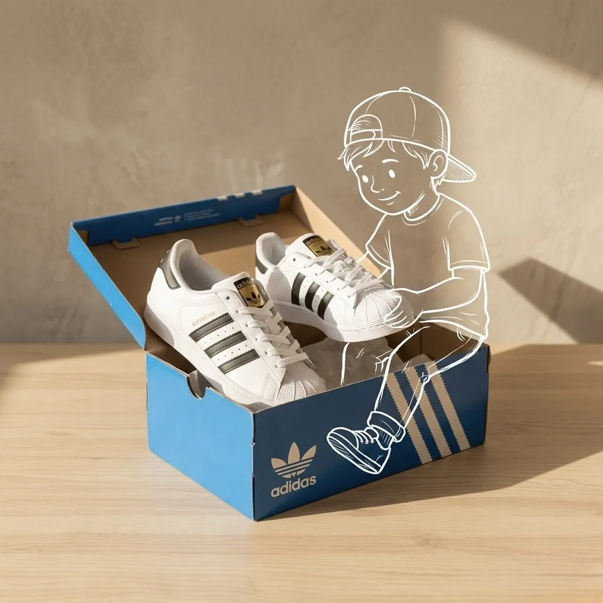

# Duet | AI — by @Sheldon056

[← Back to Examples from X](../../EXAMPLES.md) · Category: Product & Brand · Model: `Nano Banana`

<a href="https://x.com/Sheldon056/status/2029211910621806728"></a>

Original post: **[@Sheldon056 on X](https://x.com/Sheldon056/status/2029211910621806728)** · Creator: [Duet | AI](https://x.com/Sheldon056)

## Prompt

```text
Product description and its placement], minimalist product photography, clean warm studio scene, textured beige wall in the background, soft directional sunlight creating long shadows, simple table surface, the product placed in a playful conceptual composition, overlaid with a hand-drawn white outline doodle [character] interacting with the product, mixed media style combining real photography and sketch illustration, premium branding feel, shallow depth of field, ultra-realistic, no extra text, no watermarks, 8K, 1:1.
```

## Try it

Paste the prompt into **[vinano.ai](https://vinano.ai?utm_source=github&utm_medium=readme&utm_campaign=awesome-image-video-prompts-updating&utm_content=x-page-try)** to generate your own version.

> The image and prompt belong to [@Sheldon056](https://x.com/Sheldon056) and are shown here with credit for reference. Creators can ask for changes or removal by opening an issue.
