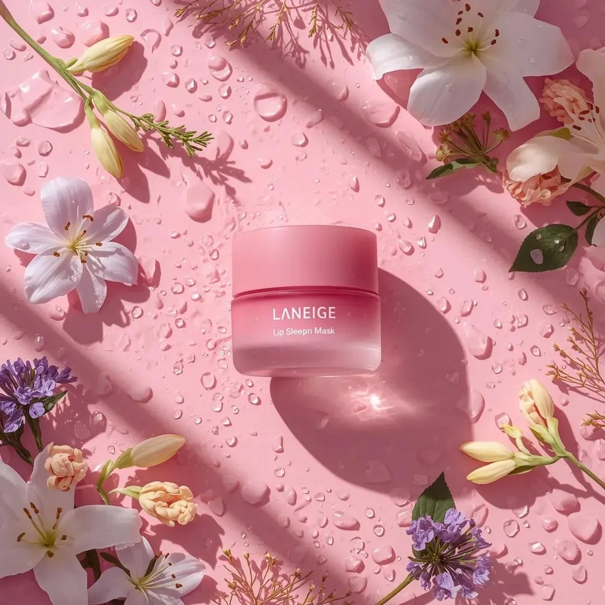

# Oogie — by @oggii_0

[← Back to Examples from X](../../EXAMPLES.md) · Category: Product & Brand · Model: `Nano Banana`

<a href="https://x.com/oggii_0/status/2019637570133717072"></a>

Original post: **[@oggii_0 on X](https://x.com/oggii_0/status/2019637570133717072)** · Creator: [Oogie](https://x.com/oggii_0)

## Prompt

```text
A hyper-realistic beauty product photograph of a pink [LANEIGE Lip Sleeping Mask] jar placed at the center of a vibrant pastel-pink surface covered in fresh water droplets, the jar upright with a frosted pink lid and glossy translucent body, surrounded organically by delicate flowers including purple blossoms, pale lilies, yellow sprigs, and green leaves arranged diagonally around the product, soft diffused studio lighting from above creating gentle highlights and natural shadows, moisture beads sparkling across the background for a fresh dewy feel, clean skincare editorial aesthetic, feminine and luxurious mood, balanced flat-lay composition, shallow depth of field, ultra-detailed textures, photorealistic, high-end cosmetic advertising style, 8K quality
```

## Try it

Paste the prompt into **[vinano.ai](https://vinano.ai?utm_source=github&utm_medium=readme&utm_campaign=awesome-image-video-prompts-updating&utm_content=x-page-try)** to generate your own version.

> The image and prompt belong to [@oggii_0](https://x.com/oggii_0) and are shown here with credit for reference. Creators can ask for changes or removal by opening an issue.
