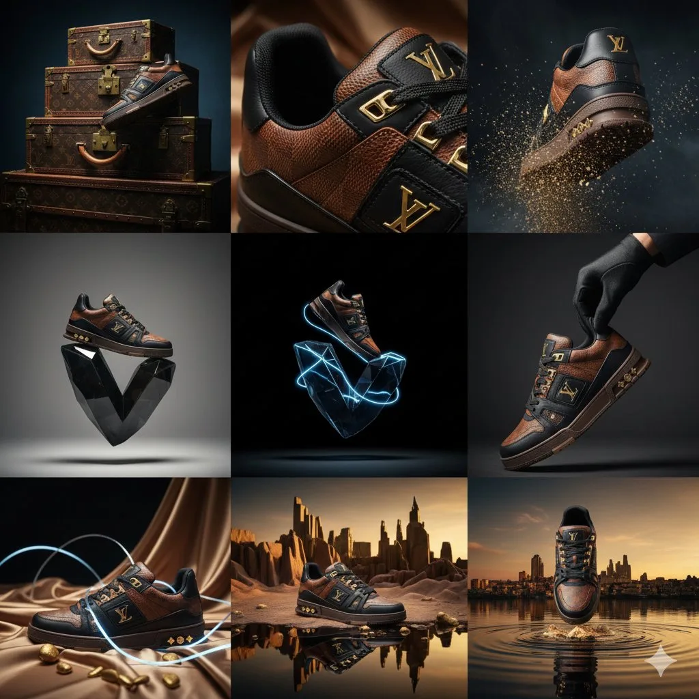

# Meem — by @mehvishs25

[← Back to Examples from X](../../EXAMPLES.md) · Category: Product & Brand · Model: `Nano Banana`

<a href="https://x.com/mehvishs25/status/2017067361673896150"></a>

Original post: **[@mehvishs25 on X](https://x.com/mehvishs25/status/2017067361673896150)** · Creator: [Meem](https://x.com/mehvishs25)

## Prompt

```text
{
  "campaign_metadata": {
    "brand_identity": "Louis Vuitton Malletier",
    "product_focus": "Luxury Leather Sneaker / Trainer",
    "aspect_ratio": "3:4",
    "aesthetic": "High-Fashion Editorial | Avant-Garde Luxury"
  },
  "visual_dna": {
    "materials": ["Full-grain calf leather", "Monogram Embossed Canvas", "Polished Gold Hardware"],
    "color_scheme": ["Cognac Brown", "Deep Obsidian", "Champagne Gold"],
    "lighting": "High-contrast Chiaroscuro | Soft-box Key Lighting"
  },
  "grid_layout_execution": {
    "row_1_heritage": {
      "cell_1_1": "Hero profile: Shoe resting on a vintage LV trunk, side-lit to show leather grain.",
      "cell_1_2": "Extreme macro: Focus on the gold-tone 'LV' lace aglets and precision stitching.",
      "cell_1_3": "Dynamic: Gold dust/particles swirling around the sole as it 'steps' into frame."
    },
    "row_2_innovation": {
      "cell_2_1": "Minimalist: The shoe balanced atop an abstract, floating glass 'V' sculpture.",
      "cell_2_2": "Floating: Deconstructed view showing the sole and upper suspended in a void.",
      "cell_2_3": "Sensory: A gloved hand adjusting the tongue, emphasizing soft leather suppleness."
    },
    "row_3_surrealism": {
      "cell_3_1": "Color Palette: Monochromatic scene in LV 'Havane' brown with liquid silk drapes.",
      "cell_3_2": "Abstraction: Symbolic representation of the rubber sole pattern as a geometric desert landscape.",
      "cell_3_3": "Fusion: The shoe walking on a mirror-still lake reflecting a Parisian sunset skyline."
    }
  }
}
```

## Try it

Paste the prompt into **[vinano.ai](https://vinano.ai?utm_source=github&utm_medium=readme&utm_campaign=awesome-image-video-prompts-updating&utm_content=x-page-try)** to generate your own version.

> The image and prompt belong to [@mehvishs25](https://x.com/mehvishs25) and are shown here with credit for reference. Creators can ask for changes or removal by opening an issue.
