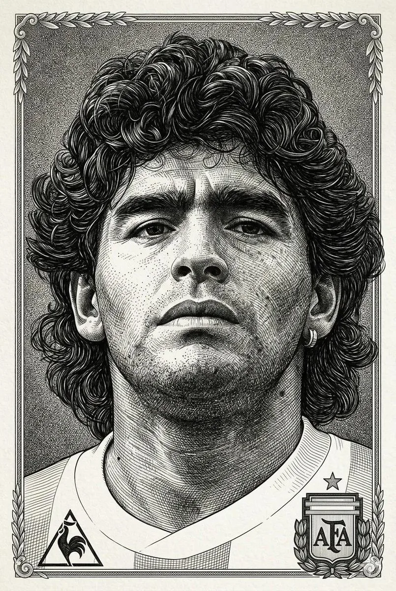

# simeon-sanai — by @Naiknelofar788

[← Back to Community Examples](../../EXAMPLES.md) · Category: Photography · Model: `Nano Banana`

<a href="https://x.com/Naiknelofar788/status/2046049269078241532"></a>

Source: **[@Naiknelofar788 on X](https://x.com/Naiknelofar788/status/2046049269078241532)** · Creator: [simeon-sanai](https://x.com/Naiknelofar788)

## Prompt

```text
Create image, aspect ratio 2:3
A close-up portrait of a person in a hyper-detailed line-art/engraving style with very dense hatching. Features only two colors: black & white/monochrome graphite. Thousands of fine lines form the skin, with dramatic lighting contrasts.
```

## Try it

Paste the prompt into **[vinano.ai](https://vinano.ai?utm_source=github&utm_medium=readme&utm_campaign=awesome-image-video-prompts-updating&utm_content=x-page-try)** to generate your own version.

> The image and prompt belong to @Naiknelofar788 ([original post](https://x.com/Naiknelofar788/status/2046049269078241532)) and are shown here with credit for reference. Creators can ask for changes or removal by opening an issue.
