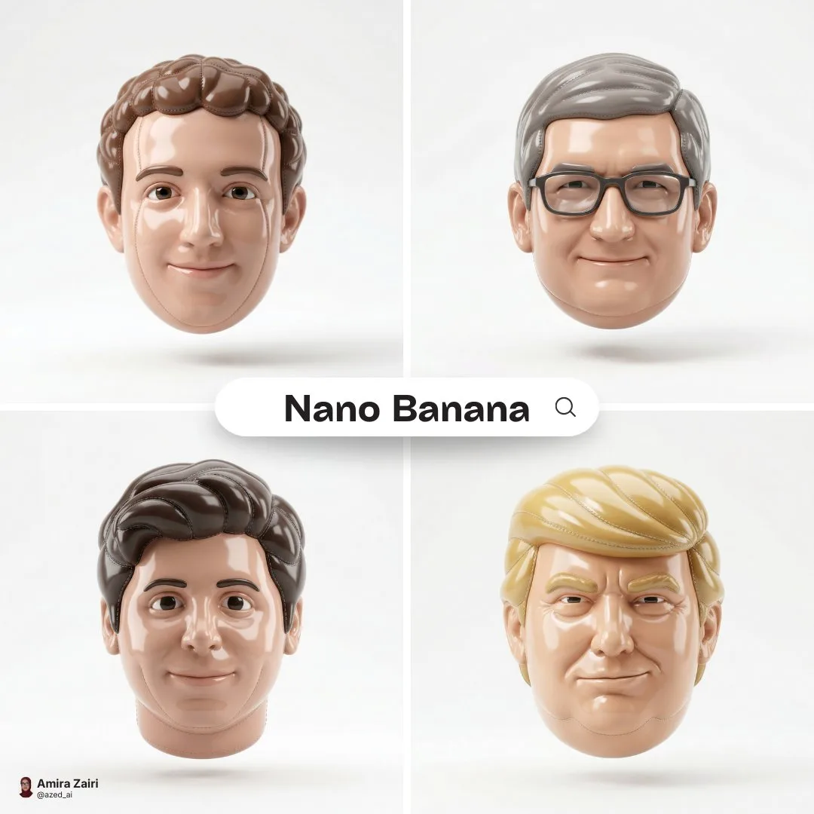

# Amira Zairi — by @azed_ai

[← Back to Examples from X](../../EXAMPLES.md) · Category: Illustration & 3D · Model: `Nano Banana`

<a href="https://x.com/azed_ai/status/2037922744856412584"></a>

Original post: **[@azed_ai on X](https://x.com/azed_ai/status/2037922744856412584)** · Creator: [Amira Zairi](https://x.com/azed_ai)

## Prompt

```text
[SUBJECT], made of smooth inflated glossy vinyl plastic, ultra-realistic 3D render, soft pillowy contours with subtle stitched panel seams, slightly rounded toy-like proportions, highly polished surface with strong specular highlights, realistic material depth, soft studio lighting creating gentle shadows and clean reflections, floating slightly above a plain light gray background, minimal composition, designer collectible aesthetic, premium art toy finish, high detail, centered composition, 1:1 aspect ratio.
```

## Try it

Paste the prompt into **[vinano.ai](https://vinano.ai?utm_source=github&utm_medium=readme&utm_campaign=awesome-image-video-prompts-updating&utm_content=x-page-try)** to generate your own version.

> The image and prompt belong to [@azed_ai](https://x.com/azed_ai) and are shown here with credit for reference. Creators can ask for changes or removal by opening an issue.
