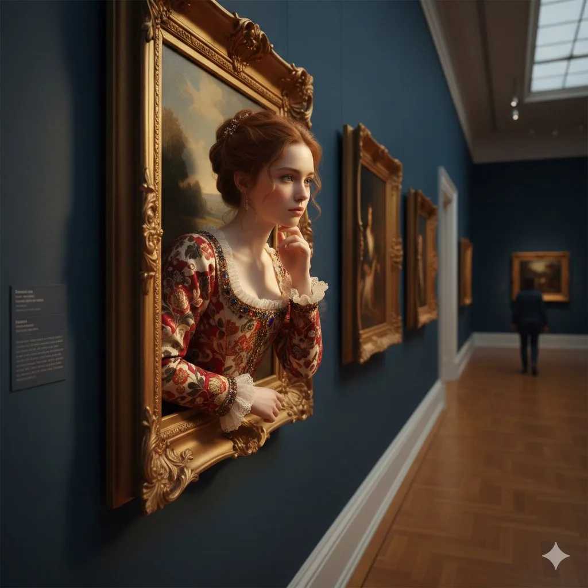

# Aijaz — by @iamsofiaijaz

[← Back to Community Examples](../../EXAMPLES.md) · Category: Photography · Model: `Nano Banana`

<a href="https://x.com/iamsofiaijaz/status/2023082481331904583"></a>

Source: **[@iamsofiaijaz on X](https://x.com/iamsofiaijaz/status/2023082481331904583)** · Creator: [Aijaz](https://x.com/iamsofiaijaz)

## Prompt

```text
A surreal, ultra-realistic scene of a young woman emerging from an ornate golden picture frame mounted on a deep blue gallery wall. She has soft auburn hair styled in an elegant updo, delicate features, and wears a richly detailed Renaissance-inspired dress with embroidered floral patterns and lace cuffs. Her chin rests thoughtfully on her hand as she gazes sideways with a pensive expression. Warm, cinematic lighting highlights her face and the gilded frame. The setting is an art gallery hallway with wooden parquet floors, framed paintings along the walls, and a softly blurred figure in the distance. Shallow depth of field, dramatic perspective, high detail, photorealistic, 8k resolution, painterly yet lifelike textures, golden hour tones
```

## Try it

Paste the prompt into **[vinano.ai](https://vinano.ai?utm_source=github&utm_medium=readme&utm_campaign=awesome-image-video-prompts-updating&utm_content=x-page-try)** to generate your own version.

> The image and prompt belong to @iamsofiaijaz ([original post](https://x.com/iamsofiaijaz/status/2023082481331904583)) and are shown here with credit for reference. Creators can ask for changes or removal by opening an issue.
