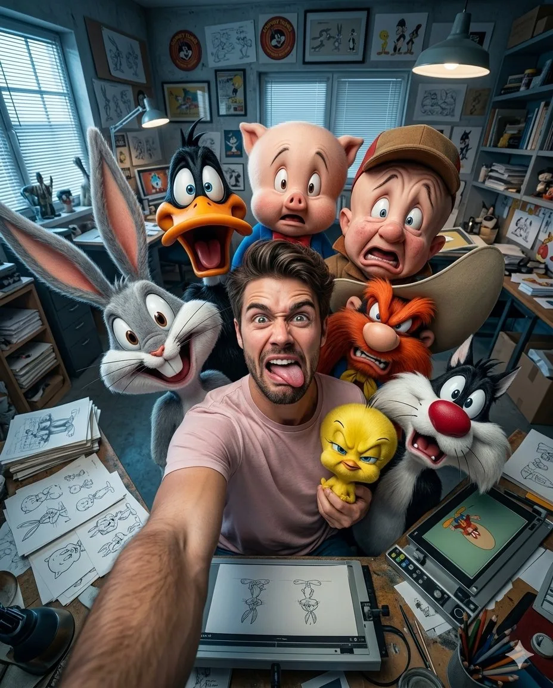

# Karlos — by @de_mon010

[← Back to Examples from X](../../EXAMPLES.md) · Category: Illustration & 3D · Model: `Nano Banana`

<a href="https://x.com/de_mon010/status/2037732319348633909"></a>

Original post: **[@de_mon010 on X](https://x.com/de_mon010/status/2037732319348633909)** · Creator: [Karlos](https://x.com/de_mon010)

## Prompt

```text
Ultra-realistic 4:5 vertical format ultra wide angle 13mm selfie of me with Bugs Bunny, Daffy Duck, Porky Pig, Elmer Fudd, Yosemite Sam, Tweety, Sylvester in my studio. I am wearing pale pink t-shirt. We're all making silly, exaggerated faces. High camera angle. Extreme wide lense no fish-eye distortion. Realistic, live action characters no cartoon, cinematic lighting, all realistic characters integrated with stylized realism.
```

## Try it

Paste the prompt into **[vinano.ai](https://vinano.ai?utm_source=github&utm_medium=readme&utm_campaign=awesome-image-video-prompts-updating&utm_content=x-page-try)** to generate your own version.

> The image and prompt belong to [@de_mon010](https://x.com/de_mon010) and are shown here with credit for reference. Creators can ask for changes or removal by opening an issue.
