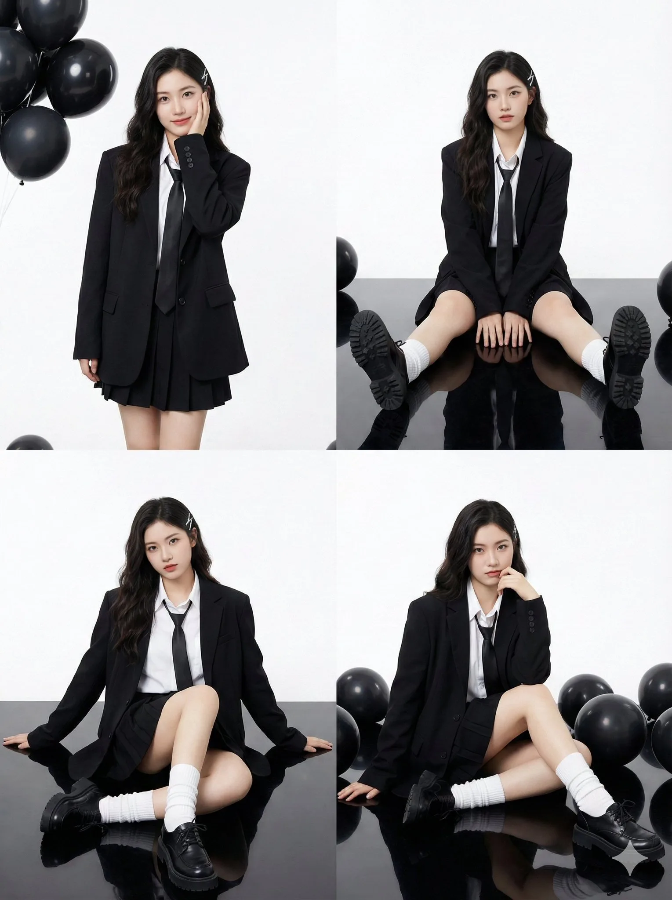

# Iqra Saifi — by @IqraSaifiii

[← Back to Community Examples](../../EXAMPLES.md) · Category: Photography · Model: `Nano Banana`

<a href="https://x.com/IqraSaifiii/status/2010421791613919416"></a>

Source: **[@IqraSaifiii on X](https://x.com/IqraSaifiii/status/2010421791613919416)** · Creator: [Iqra Saifi](https://x.com/IqraSaifiii)

## Prompt

```text
{
"Young Asian woman, pale porcelain skin, long dark wavy hair with side bangs.",
      "accessories": "A silver rectangular hair clip on the left side of the head.",
      "apparel": {
        "outerwear": "Oversized black structured blazer (suit jacket).",
        "inner": "White collared button-up shirt, loose black necktie.",
        "bottoms": "Black pleated mini skirt (mostly obscured by the oversized blazer).",
        "legwear": "White loose slouch socks (leg warmers style) scrunching at the ankles.",
        "footwear": "Black chunky leather platform derby shoes."
      },
      "makeup": "K-pop/Douyin style: fair skin, soft gradient red lips, subtle blush, defined eyeliner."

"2x2 Photo Collage (4-Panel Grid).",
    },
    "environment_and_props": {
      "studio_setting": "High-key photography studio.",
      "background": "Seamless bright white backdrop.",
      "flooring": "Glossy black reflective floor (creating clear reflections of the shoes and legs).",
      "props": "Cluster of black helium balloons (matte and glossy finish) visible in the top-left and scattered on the floor in other panels."
    },
    "panel_pose_breakdown": {
      "panel_1_top_left": {
        "framing": "Thigh-up shot.",
        "pose": "Standing straight. Left hand rests gently against the left cheek (palm facing jaw). Right arm hangs naturally by side. Head tilted slightly.",
        "gaze": "Looking directly at camera with a soft smile.",
        "prop_placement": "Black balloons floating in the top left corner."
      },
      "panel_2_top_right": {
        "framing": "Full body, seated.",
        "pose": "Sitting on the floor with knees bent upwards and feet flat on the ground. Hands resting loosely on the floor between legs or on shins.",
        "gaze": "Direct eye contact, neutral expression.",
        "details": "Symmetrical composition."
      },
      "panel_3_bottom_left": {
        "framing": "Full body, seated angle.",
        "pose": "Sitting on the floor, leaning torso back, supporting weight with both arms extended behind her. Legs bent, one knee angled higher than the other.",
        "gaze": "Looking slightly to the side with a cool attitude."
      },
      "panel_4_bottom_right": {
        "framing": "Full body, seated.",
        "pose": "Sitting with legs bent to the side. Left hand is raised, touching the chin/neck area thoughtfully. Right arm extended back for support.",
        "gaze": "Direct eye contact, slight smirk."
      }
    },
    "camera_technical_values": {
      "lens": "50mm to 85mm (Standard portrait lens).",
      "aperture": "f/8.0 (Deep depth of field, keeping the entire subject sharp against the white background).",
      "shutter_speed": "1/160s (Studio sync).",
      "iso": "ISO 100 (Clean, noise-free image).",
      "lighting_setup": "Softbox lighting. Large diffuse light source from the front to create shadowless, flattering illumination on the face ('Beauty Light').",
      "contrast": "High contrast between the black outfit and the stark white background."
```

## Try it

Paste the prompt into **[vinano.ai](https://vinano.ai?utm_source=github&utm_medium=readme&utm_campaign=awesome-image-video-prompts-updating&utm_content=x-page-try)** to generate your own version.

> The image and prompt belong to @IqraSaifiii ([original post](https://x.com/IqraSaifiii/status/2010421791613919416)) and are shown here with credit for reference. Creators can ask for changes or removal by opening an issue.
