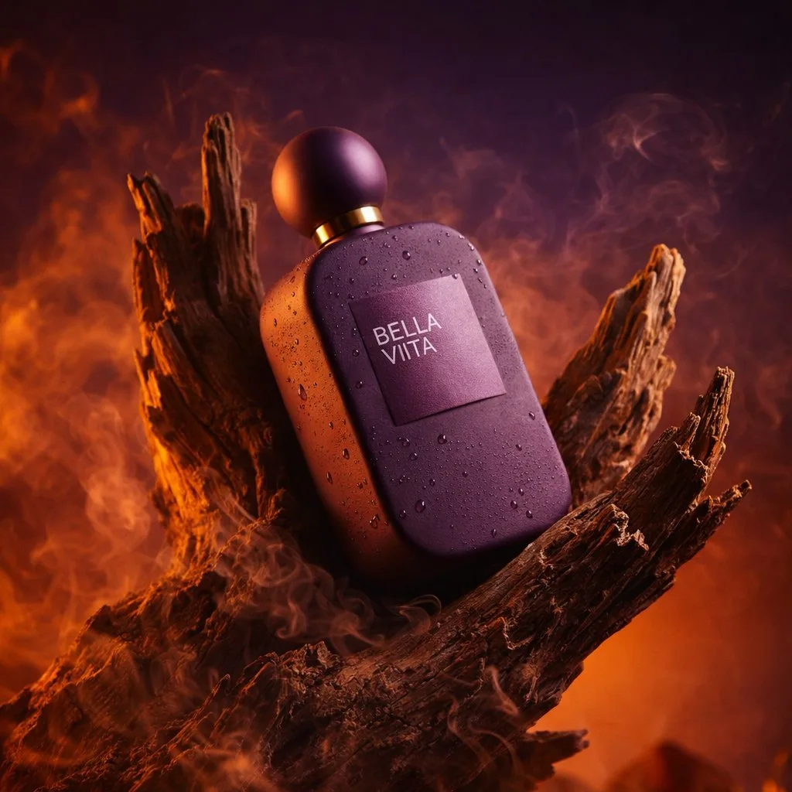

# ShaHid WaNii — by @meng_dagg695

[← Back to Community Examples](../../EXAMPLES.md) · Category: Product & Brand · Model: `Nano Banana`

<a href="https://x.com/meng_dagg695/status/2020094371107074147"></a>

Source: **[@meng_dagg695 on X](https://x.com/meng_dagg695/status/2020094371107074147)** · Creator: [ShaHid WaNii](https://x.com/meng_dagg695)

## Prompt

```text
{
  "master_prompt": {
    "global_settings": {
      "resolution": "8K",
      "aspect_ratio": "1:1",
      "image_type": "photorealistic AI-generated product photography",
      "detail_level": "ultra-high detail, macro clarity",
      "noise": "none",
      "artifacts": "none",
      "focus": "sharp subject, controlled depth of field"
    },

    "module_1_image_1_style": {
      "subject": {
        "object_type": "cosmetic bottle",
        "label_text_visible": "NAHDA SKINCARE",
        "product_type_text": "SHOWER GEL / SHOWER GEL",
        "bottle_material": "frosted translucent glass",
        "liquid_color": "soft pale yellow",
        "shape": "cylindrical with rounded shoulders",
        "cap": {
          "material": "metallic",
          "color": "silver",
          "surface_pattern": "hexagonal honeycomb texture",
          "finish": "matte"
        },
        "surface_details": "small and medium water droplets evenly distributed"
      },
      "environment": {
        "setting": "forest floor",
        "base_surface": "weathered tree stump",
        "surroundings": [
          "green moss",
          "small yellow wildflowers",
          "tree trunk to the right",
          "fine spider web attached to moss"
        ],
        "background": "soft forest bokeh with diffused sunlight",
        "atmosphere": "humid, natural, calm"
      },
      "lighting": {
        "type": "natural diffused light",
        "direction": "soft backlight and side illumination",
        "highlights": "gentle glow through liquid",
        "shadows": "soft, natural"
      },
      "camera": {
        "angle": "eye-level product shot",
        "lens_style": "macro product photography",
        "depth_of_field": "shallow"
      },
      "color_palette": [
        "pale yellow",
        "soft green",
        "natural brown",
        "muted gold"
      ]
    },

    "module_2_image_2_style": {
      "subject": {
        "object_type": "perfume bottle",
        "label_text_visible": "FOREST",
        "bottle_color": "deep matte green",
        "material": "opaque glass",
        "shape": "rectangular with rounded edges",
        "cap": {
          "material": "metallic",
          "color": "gold",
          "finish": "glossy cylindrical"
        },
        "surface_details": "dense fine water droplets covering bottle"
      },
      "environment": {
        "setting": "forest pathway",
        "base_surface": "moss-covered stone or log",
        "foreground_elements": [
          "orange autumn leaf",
          "fallen brown leaves"
        ],
        "background": "tall trees fading into mist",
        "atmosphere": "misty, cool, forest depth"
      },
      "lighting": {
        "type": "warm ambient forest light",
        "direction": "top-front diffused",
        "effects": "soft glow and mist illumination"
      },
      "camera": {
        "angle": "straight-on centered composition",
        "lens_style": "portrait product lens",
        "depth_of_field": "moderate with soft background blur"
      },
      "color_palette": [
        "forest green",
        "gold",
        "autumn orange",
        "earth brown"
```

## Try it

Paste the prompt into **[vinano.ai](https://vinano.ai?utm_source=github&utm_medium=readme&utm_campaign=awesome-image-video-prompts-updating&utm_content=x-page-try)** to generate your own version.

> The image and prompt belong to @meng_dagg695 ([original post](https://x.com/meng_dagg695/status/2020094371107074147)) and are shown here with credit for reference. Creators can ask for changes or removal by opening an issue.
