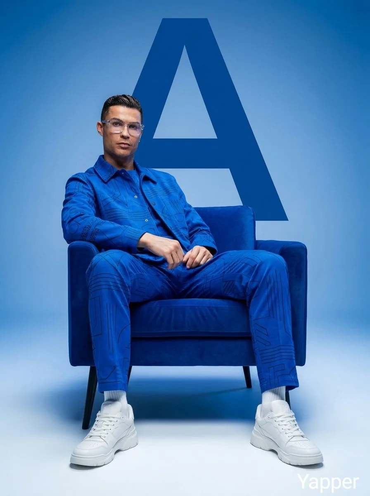

# Taaruk — by @Taaruk_

[← Back to Community Examples](../../EXAMPLES.md) · Category: Poster Design · Model: `Nano Banana`

<a href="https://x.com/Taaruk_/status/2033180206975135824"></a>

Source: **[@Taaruk_ on X](https://x.com/Taaruk_/status/2033180206975135824)** · Creator: [Taaruk](https://x.com/Taaruk_)

## Prompt

```text
Minimalist fashion studio photoshoot featuring stylish people sitting confidently on a modern chair, monochromatic aesthetic, subjects wearing bold cobalt-blue outfits (tailored suit or modern streetwear set) with white sneakers and clear glasses, relaxed powerful pose with legs apart and hands resting naturally, clean blue studio background with a large geometric letter “A” behind them, soft professional studio lighting, fashion editorial composition, modern luxury brand campaign style, ultra-realistic, sharp focus, high detail, 8K.
```

## Try it

Paste the prompt into **[vinano.ai](https://vinano.ai?utm_source=github&utm_medium=readme&utm_campaign=awesome-image-video-prompts-updating&utm_content=x-page-try)** to generate your own version.

> The image and prompt belong to @Taaruk_ ([original post](https://x.com/Taaruk_/status/2033180206975135824)) and are shown here with credit for reference. Creators can ask for changes or removal by opening an issue.
