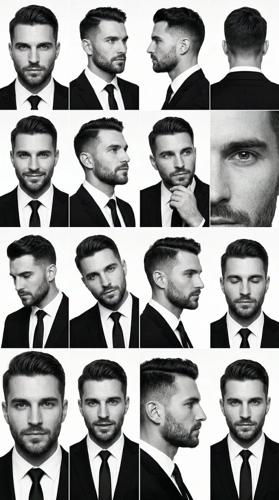

# Özge Döner — by @astronomerozge1

[← Back to Community Examples](../../EXAMPLES.md) · Category: Photography · Model: `Nano Banana`

<a href="https://x.com/astronomerozge1/status/2027499546545148011"></a>

Source: **[@astronomerozge1 on X](https://x.com/astronomerozge1/status/2027499546545148011)** · Creator: [Özge Döner](https://x.com/astronomerozge1)

## Prompt

```text
{
 "generation_request": {
 "meta_data": {
 "task_type": "bw_male_expression_grid_identity_swap",
 "language": "en",
 "priority": "highest",
 "version": "v1.0_BW_MALE_GRID_KEEP_POSES_SWAP_IDENTITY"
 },
 "input": {
 "mode": "image_to_image",
 "reference_image_usage": "very_high",
 "preserve_identity": true,
 "preserve_facial_features": true,
 "preserve_hairstyle": true,
 "notes": "PRIMARY STRUCTURE ANCHOR: use the uploaded male 4x4 grid image (suit photobooth). Keep the exact 4x4 layout, crop, spacing, poses, gestures, hand placements, and framing in every panel. PRIMARY IDENTITY ANCHOR: use the uploaded reference photo of the target adult man. Replace the man in ALL panels with the reference identity while preserving the original pose and expression intensity. Keep suit-and-tie styling and clean studio background. Maintain consistent identity across all 16 panels."
 },
 "output": {
 "aspect_ratio": "1:1",
 "resolution": "ultra_high",
 "num_images": 1,
 "layout": {
 "type": "grid",
 "rows": 4,
 "cols": 4,
 "gutter": "thin",
 "panel_consistency": "very_high"
 },
 "sharpness": "crisp_studio",
 "grain": "subtle_analog_bw"
 },
 "scene": {
 "environment": "clean white studio backdrop",
 "lighting": {
 "style": "high-key studio",
 "key_light": "front softbox",
 "fill": "balanced fill",
 "avoid": "dramatic cinematic shadows"
 },
 "camera": {
 "lens": "50mm",
 "framing": "mid chest to head (varies per panel but keep same as structure image)",
 "focus": "eyes sharp"
 }
 },
 "subject": {
 "type": "adult man",
 "wardrobe": "black suit, white shirt, black tie (match structure image), no logos",
 "grooming": "match reference hairstyle as closely as possible while keeping overall look consistent",
 "anatomy_rules": "realistic hands, correct fingers, no distortions"
 },
 "style": {
 "color": "pure black and white",
 "contrast": "medium_high",
 "background": "keep identical to structure image",
 "finish": "clean studio print look"
 },
 "quality_control": {
 "identity_lock": "strict",
 "hands_priority": "very_high",
 "avoid": [
 "extra fingers",
 "missing fingers",
 "deformed hands",
 "warped face",
 "uneven eyes",
 "melted mouth",
 "identity drift across panels",
 "text",
 "watermark",
 "logo"
 ]
 },
 "negative_prompt": [
 "color",
 "sepia",
 "cinematic lighting",
 "blur",
 "low resolution",
 "distorted anatomy",
 "plastic skin",
 "face mismatch"
 ]
 }
}
```

## Try it

Paste the prompt into **[vinano.ai](https://vinano.ai?utm_source=github&utm_medium=readme&utm_campaign=awesome-image-video-prompts-updating&utm_content=x-page-try)** to generate your own version.

> The image and prompt belong to @astronomerozge1 ([original post](https://x.com/astronomerozge1/status/2027499546545148011)) and are shown here with credit for reference. Creators can ask for changes or removal by opening an issue.
