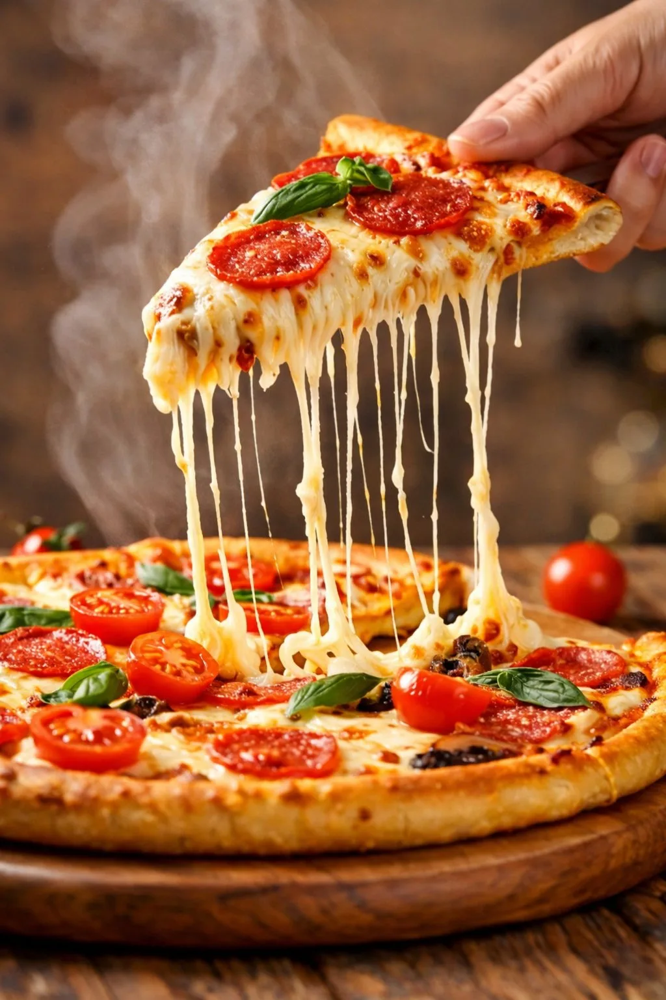

# 𝐌 — by @Strength04_X

[← Back to Community Examples](../../EXAMPLES.md) · Category: Food & Drink · Model: `Nano Banana`

<a href="https://x.com/Strength04_X/status/2008416515129999715"></a>

Source: **[@Strength04_X on X](https://x.com/Strength04_X/status/2008416515129999715)** · Creator: [𝐌](https://x.com/Strength04_X)

## Prompt

```text
A hyper-realistic, cinematic close-up of a freshly baked pepperoni pizza slice being lifted from the pie, with long, dramatic cheese pulls stretching down in silky strands.
Golden, slightly charred crust with visible texture, bubbling mozzarella, glossy pepperoni slices, fresh basil leaves on top, and juicy cherry tomatoes scattered across the pizza.
Soft steam rising from the hot slice, creating a warm, mouth-watering atmosphere.
Shot on a DSLR, 50mm lens, shallow depth of field, sharp focus on the cheese stretch, background softly blurred.
Warm studio lighting with natural highlights, rich colors, realistic shadows, premium food-advertisement look.
```

## Try it

Paste the prompt into **[vinano.ai](https://vinano.ai?utm_source=github&utm_medium=readme&utm_campaign=awesome-image-video-prompts-updating&utm_content=x-page-try)** to generate your own version.

> The image and prompt belong to @Strength04_X ([original post](https://x.com/Strength04_X/status/2008416515129999715)) and are shown here with credit for reference. Creators can ask for changes or removal by opening an issue.
