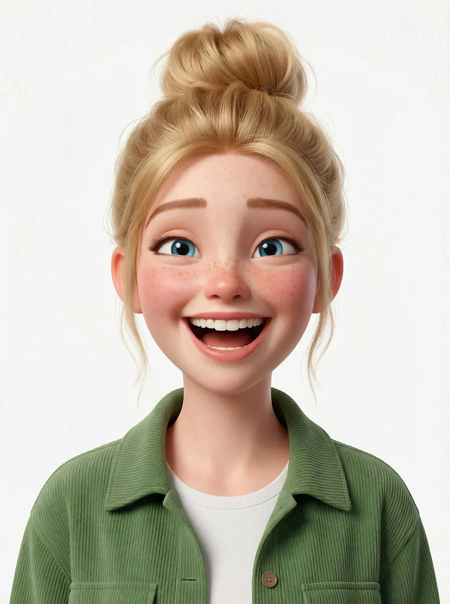

# Oogie — by @oggii_0

[← Back to Community Examples](../../EXAMPLES.md) · Category: Illustration & 3D · Model: `Nano Banana`

<a href="https://x.com/oggii_0/status/2040691670384366063"></a>

Source: **[@oggii_0 on X](https://x.com/oggii_0/status/2040691670384366063)** · Creator: [Oogie](https://x.com/oggii_0)

## Prompt

```text
Create a head-and-shoulders Pixar-style 3D avatar of an edgy person based on the reference image with a black bob, purple hair streak, and a small nose ring. She has a defiant, playful expression, sticking her tongue out with wide, confident eyes while wearing a classic denim jacket. Isolated on a seamless white background, the render features flawless 3D skin and soft cinematic lighting for a clean, minimalist aesthetic.
```

## Try it

Paste the prompt into **[vinano.ai](https://vinano.ai?utm_source=github&utm_medium=readme&utm_campaign=awesome-image-video-prompts-updating&utm_content=x-page-try)** to generate your own version.

> The image and prompt belong to @oggii_0 ([original post](https://x.com/oggii_0/status/2040691670384366063)) and are shown here with credit for reference. Creators can ask for changes or removal by opening an issue.
