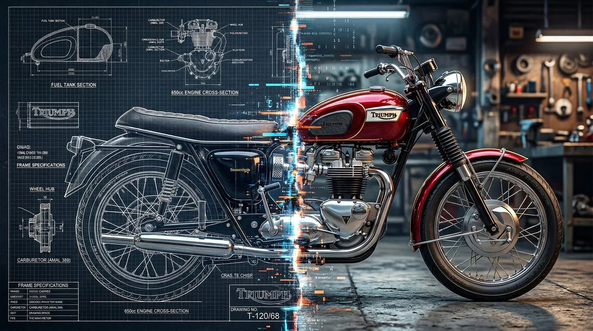

# Glenn Williams — by @GlennHasABeard

[← Back to Examples from X](../../EXAMPLES.md) · Category: Illustration & 3D · Model: `Nano Banana`

<a href="https://x.com/GlennHasABeard/status/2030420620232561024"></a>

Original post: **[@GlennHasABeard on X](https://x.com/GlennHasABeard/status/2030420620232561024)** · Creator: [Glenn Williams](https://x.com/GlennHasABeard)

## Prompt

```text
A [subject] split vertically down the center, left half as a [adjective] technical blueprint, right half as a [adjective] 3D render, the seam between them glitching where both realities collide.
```

## Try it

Paste the prompt into **[vinano.ai](https://vinano.ai?utm_source=github&utm_medium=readme&utm_campaign=awesome-image-video-prompts-updating&utm_content=x-page-try)** to generate your own version.

> The image and prompt belong to [@GlennHasABeard](https://x.com/GlennHasABeard) and are shown here with credit for reference. Creators can ask for changes or removal by opening an issue.
