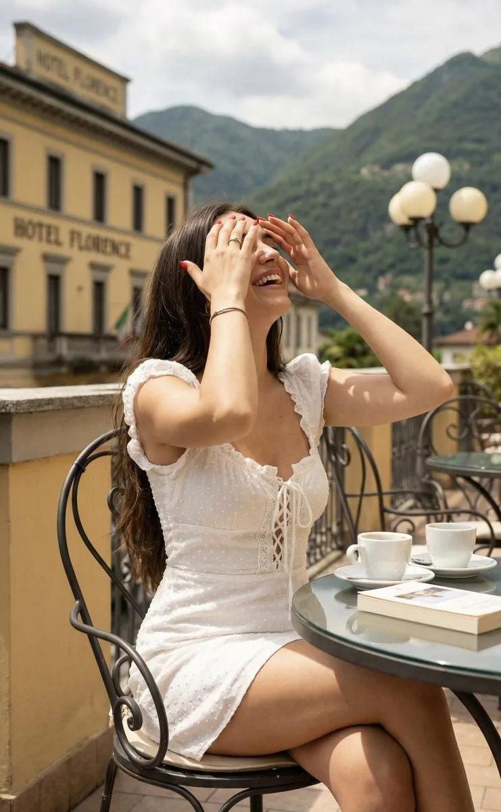

# Iris — by @xIrissy

[← Back to Community Examples](../../EXAMPLES.md) · Category: Photography · Model: `Nano Banana`

<a href="https://x.com/xIrissy/status/2011768378969481414"></a>

Source: **[@xIrissy on X](https://x.com/xIrissy/status/2011768378969481414)** · Creator: [Iris](https://x.com/xIrissy)

## Prompt

```text
{
  "prompt_type": "Ultra Photorealistic Image Generation",
  "subject": {
    "description": "Young woman with long, straight dark brown hair cascading down her back",
    "skin_tone": "Sun-kissed, glowing complexion",
    "features": "Side profile visible, smiling/laughing expression, hands raised covering eyes/face playfully",
    "details": "Red manicured fingernails, subtle jewelry including a ring on the left hand and a thin bracelet"
  },
  "fashion_and_styling": {
    "outfit": "White, vintage-inspired corset-style mini dress with Swiss dot texture",
    "garment_details": "Sweetheart neckline, ruffled cap sleeves, front lace-up ribbon detailing, fitted bodice, ruffled hem, slightly sheer fabric",
    "aesthetic": "Coquette, cottagecore, soft feminine luxury, summer vacation style"
  },
  "pose_and_action": {
    "pose": "Seated elegantly on a chair, body angled slightly away from the camera",
    "gesture": "Both hands raised to shield eyes from the sun or in a candid moment of laughter, head tilted back slightly",
    "interaction": "Relaxed posture sitting at a cafe table"
  },
  "environment": {
    "setting": "Outdoor luxury hotel terrace or cafe balcony overlooking a scenic landscape",
    "background_elements": "Historic yellow building with 'HOTEL FLORENCE' signage, lush green mountains in the distance, cloudy blue sky, vintage globe street lamps",
    "foreground_elements": "Round glass-top table, black wrought-iron garden chairs",
    "props": "Two white ceramic coffee cups on saucers, a paperback book lying on the table"
  },
  "lighting": {
    "type": "Natural bright daylight, afternoon sun",
    "quality": "High contrast, casting sharp shadows on the table, backlighting on hair creating a halo effect, sun-drenched atmosphere",
    "direction": "Side/Front lighting illuminating the subject"
  },
  "mood_and_atmosphere": {
    "vibe": "Joyful, candid, luxurious, carefree, Italian summer holiday",
    "emotion": "Happiness, relaxation, playfulness"
  },
  "technical_camera_details": {
    "quality": "8k resolution, RAW photo, hyper-realistic, highly detailed texture",
    "camera_simulation": "DSLR, 85mm portrait lens",
    "aperture": "f/2.8 (shallow depth of field to blur the background mountains and hotel)",
    "shutter_speed": "1/500s (to freeze the candid movement)",
    "iso": "100 (clean, noise-free image)",
    "color_grading": "Vibrant, natural colors with slightly warm tones, clear whites"
  }
}
```

## Try it

Paste the prompt into **[vinano.ai](https://vinano.ai?utm_source=github&utm_medium=readme&utm_campaign=awesome-image-video-prompts-updating&utm_content=x-page-try)** to generate your own version.

> The image and prompt belong to @xIrissy ([original post](https://x.com/xIrissy/status/2011768378969481414)) and are shown here with credit for reference. Creators can ask for changes or removal by opening an issue.
