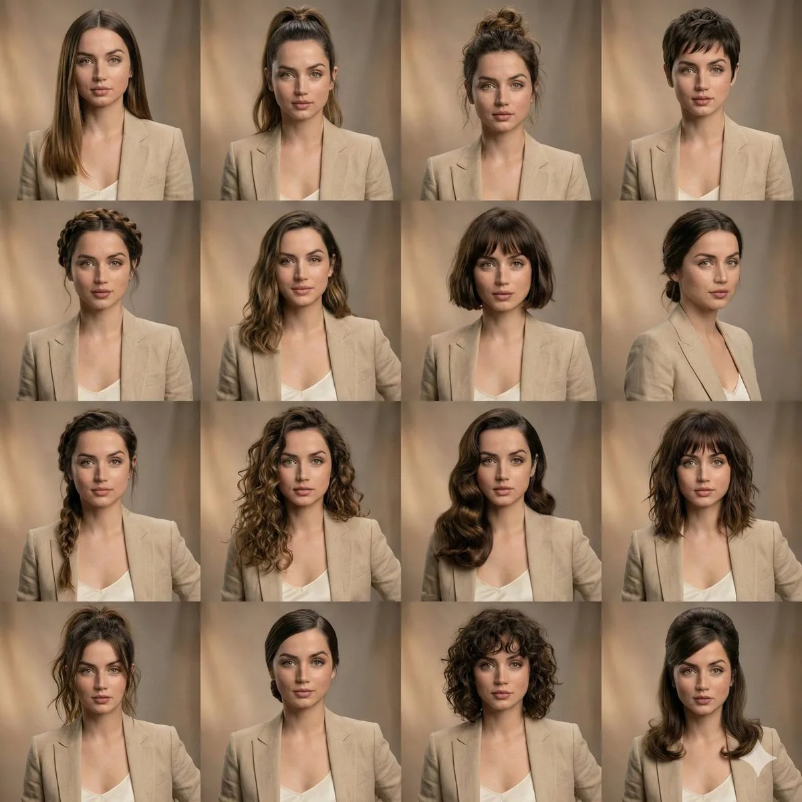

# Johnn — by @john_my07

[← Back to Community Examples](../../EXAMPLES.md) · Category: Photography · Model: `Nano Banana`

<a href="https://x.com/john_my07/status/2013525972524712055"></a>

Source: **[@john_my07 on X](https://x.com/john_my07/status/2013525972524712055)** · Creator: [Johnn](https://x.com/john_my07)

## Prompt

```text
{
  "scene_type": "editorial beauty collage",
  "subject": {
    "identity_lock": true,
    "face_consistency": "perfectly matched across all frames",
    "expression": "unchanged, neutral and relaxed",
    "skin": "realistic texture, natural pores, high fidelity"
  },
  "layout": {
    "grid": "4x3",
    "framing": "equal-sized portrait panels",
    "consistency": "symmetrical facial alignment in every frame"
  },
  "hairstyle_variations": [
    "sleek long straight hair",
    "high ponytail",
    "textured messy bun",
    "pixie haircut",
    "braided crown",
    "soft flowing waves",
    "short bob with bangs",
    "low tied bun",
    "side braid",
    "loose defined curls"
  ],
  "styling": {
    "outfit": "same neutral wardrobe across all panels",
    "makeup": "identical clean beauty makeup in every shot"
  },
  "lighting": {
    "type": "soft studio lighting",
    "tone": "warm",
    "shadows": "gentle and natural"
  },
  "background": {
    "style": "subtle blurred studio backdrop",
    "color": "warm neutral tones"
  },
  "quality": {
    "detail": "ultra-detailed",
    "photography": "professional portrait",
    "finish": "high-end editorial look"
  }
}
```

## Try it

Paste the prompt into **[vinano.ai](https://vinano.ai?utm_source=github&utm_medium=readme&utm_campaign=awesome-image-video-prompts-updating&utm_content=x-page-try)** to generate your own version.

> The image and prompt belong to @john_my07 ([original post](https://x.com/john_my07/status/2013525972524712055)) and are shown here with credit for reference. Creators can ask for changes or removal by opening an issue.
