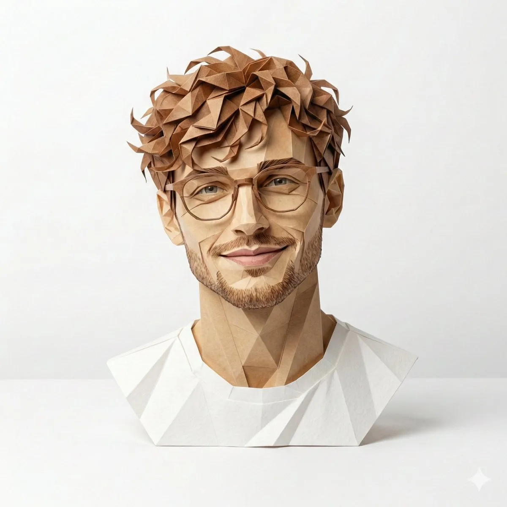

# Yaseen Khan Gul — by @YaseenK7212

[← Back to Community Examples](../../EXAMPLES.md) · Category: Illustration & 3D · Model: `Nano Banana`

<a href="https://x.com/YaseenK7212/status/2022187418502217977"></a>

Source: **[@YaseenK7212 on X](https://x.com/YaseenK7212/status/2022187418502217977)** · Creator: [Yaseen Khan Gul](https://x.com/YaseenK7212)

## Prompt

```text
A hyper-detailed, origami-style version of a person, folded from high-quality paper with crisp, clean edges and a realistic paper texture. Intricate geometric folds capture the character’s iconic shape and expressions. Use the same color palette as the reference photo (no black). Place it on a clean studio surface with soft, natural shadows. A minimalist collectible art aesthetic; ultra-photorealistic; 8k, 1080×1080 square.
```

## Try it

Paste the prompt into **[vinano.ai](https://vinano.ai?utm_source=github&utm_medium=readme&utm_campaign=awesome-image-video-prompts-updating&utm_content=x-page-try)** to generate your own version.

> The image and prompt belong to @YaseenK7212 ([original post](https://x.com/YaseenK7212/status/2022187418502217977)) and are shown here with credit for reference. Creators can ask for changes or removal by opening an issue.
