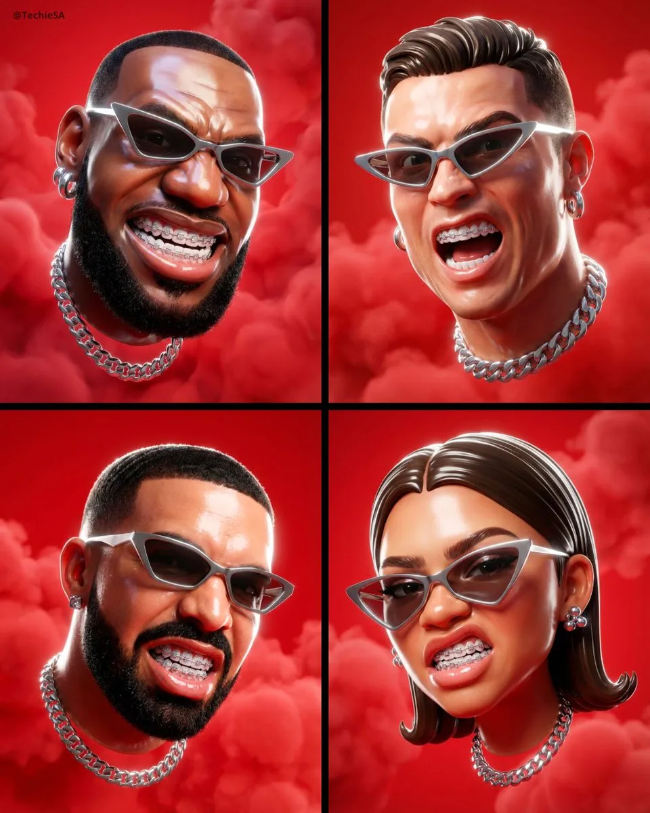

# TechieSA — by @TechieBySA

[← Back to Community Examples](../../EXAMPLES.md) · Category: Illustration & 3D · Model: `Nano Banana`

<a href="https://x.com/TechieBySA/status/2024450766874751356"></a>

Source: **[@TechieBySA on X](https://x.com/TechieBySA/status/2024450766874751356)** · Creator: [TechieSA](https://x.com/TechieBySA)

## Prompt

```text
A hyper-stylized, dynamic 3D head portrait floats against a vivid red background with soft volumetric clouds and seamless shading. Only the cartoonish 3D head appears, with no neck visible, and facial features closely matching the reference photo. The head is tilted and fills approximately 80% of the frame. The character displays a fierce, aggressive expression with a wide snarl, revealing teeth adorned with diamond-studded braces. Sharp, angular silver sunglasses with pointed frames fit the face precisely. Additional accessories include chrome earrings and a chunky silver chain necklace. Lighting is bold and metallic, combining strong rim lights from above and behind with a luminous frontal fill that sculpts facial contours and creates glossy skin highlights. The overall look features over-the-top glossy realism, exaggerated proportions, intense reflections, and a futuristic, high-energy aesthetic with partial overlap of elements to enhance depth and dramatic presence. Hyper-detailed 3D forms add vibrant, cinematic intensity and visual impact. Aspect ratio 4:5
```

## Try it

Paste the prompt into **[vinano.ai](https://vinano.ai?utm_source=github&utm_medium=readme&utm_campaign=awesome-image-video-prompts-updating&utm_content=x-page-try)** to generate your own version.

> The image and prompt belong to @TechieBySA ([original post](https://x.com/TechieBySA/status/2024450766874751356)) and are shown here with credit for reference. Creators can ask for changes or removal by opening an issue.
