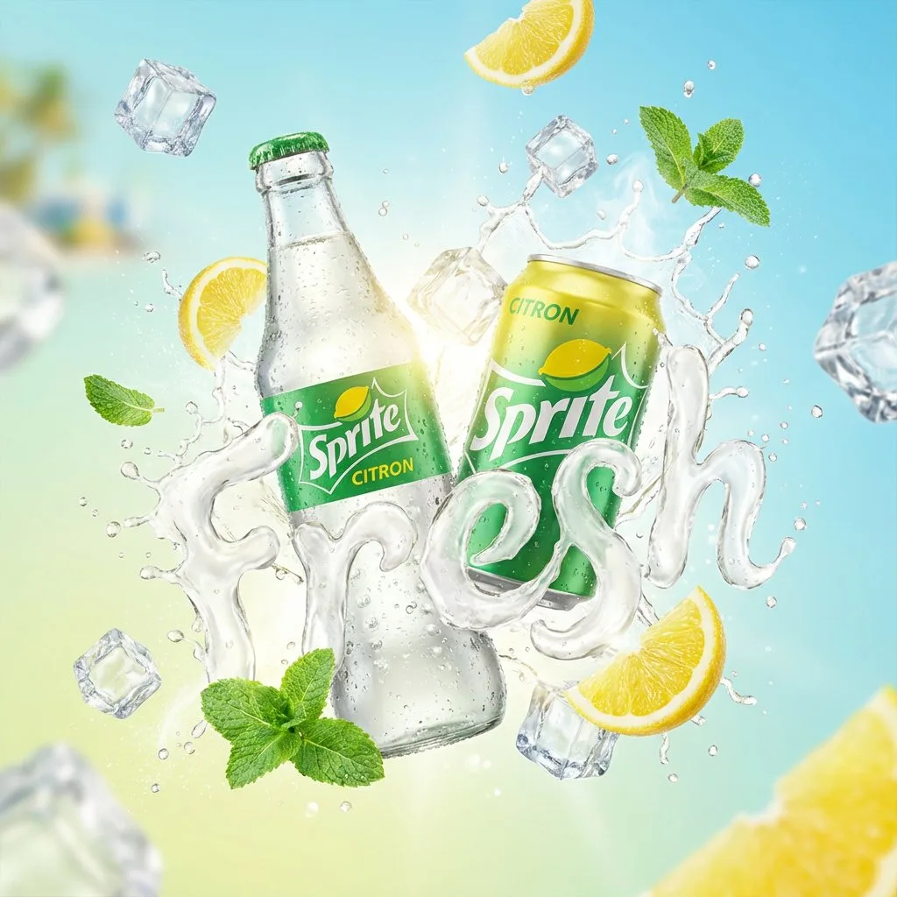

# Mo — by @Kerroudjm

[← Back to Community Examples](../../EXAMPLES.md) · Category: Product & Brand · Model: `Nano Banana`

<a href="https://x.com/Kerroudjm/status/2011108316882014431"></a>

Source: **[@Kerroudjm on X](https://x.com/Kerroudjm/status/2011108316882014431)** · Creator: [Mo](https://x.com/Kerroudjm)

## Prompt

```text
A vibrant, high-end advertising visual of a [PRODUCT NAME] can/bottle floating dynamically in the center. The background is a soft gradient inspired by the drink’s color, blending into fresh sky-blue tones for a refreshing summer feel.  A powerful splash of [LIQUID TYPE] explodes around the product, forming the word ”[WORD]” in smooth, fluid, organic liquid typography.  Crystal-clear ice cubes burst around the composition, with fresh [FRUITS RELATED TO THE DRINK] (whole and sliced) flying in the air. Juicy splashes, droplets, light mist, and condensation create an intense refreshing atmosphere.  Bright sunlight, glossy highlights, commercial lighting, premium brand look, dynamic motion, hyper-detailed, semi-realistic illustration style, ultra-clean, 4k, sharp focus.
```

## Try it

Paste the prompt into **[vinano.ai](https://vinano.ai?utm_source=github&utm_medium=readme&utm_campaign=awesome-image-video-prompts-updating&utm_content=x-page-try)** to generate your own version.

> The image and prompt belong to @Kerroudjm ([original post](https://x.com/Kerroudjm/status/2011108316882014431)) and are shown here with credit for reference. Creators can ask for changes or removal by opening an issue.
