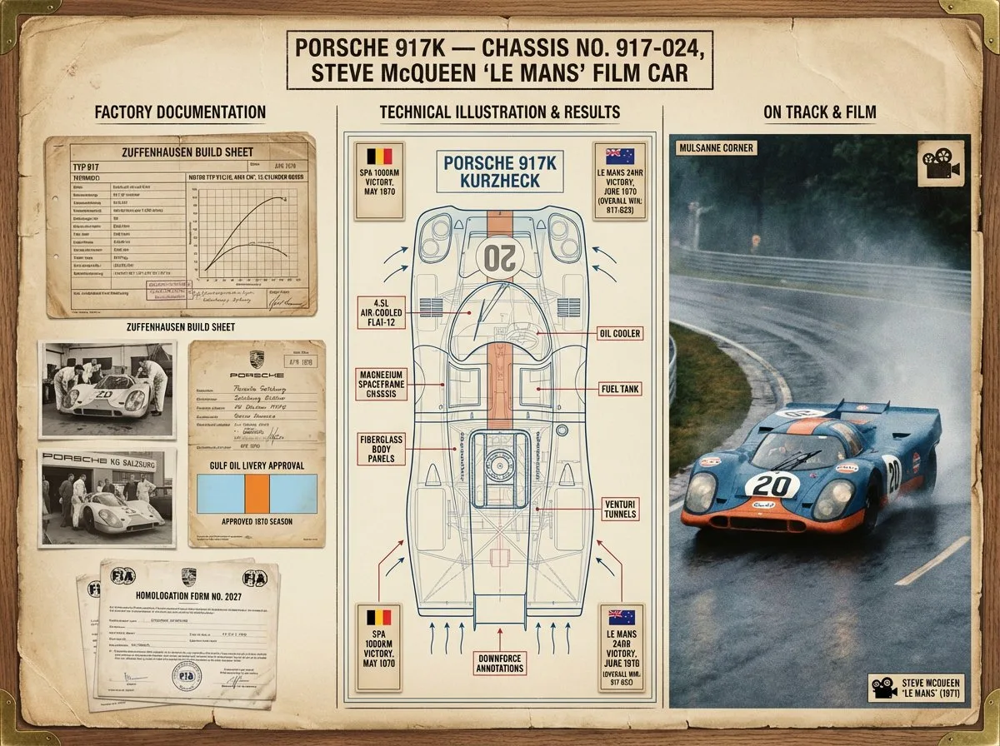

# Alexandra Aisling — by @AllaAisling

[← Back to Examples from X](../../EXAMPLES.md) · Category: Illustration & 3D · Model: `Nano Banana`

<a href="https://x.com/AllaAisling/status/2009284710862643206"></a>

Original post: **[@AllaAisling on X](https://x.com/AllaAisling/status/2009284710862643206)** · Creator: [Alexandra Aisling](https://x.com/AllaAisling)

## Prompt

```text
A marque historian's documentation board for [VEHICLE] — [MODEL / VARIANT / YEAR]. Left section: factory documentation including original specification sheet, production line photographs, period advertising, and chassis number registry. Center section: technical illustration showing powertrain in phantom view, suspension geometry, aerodynamic annotations, and material callouts, surrounded by period racing results or ownership provenance. Right section: the vehicle in its defining environment, whether racing circuit, mountain pass, or boulevard, captured with period-appropriate color grading and motion. Visual style transitions from archival document cream through engineering-drawing precision to saturated automotive photography. Title block reading "[VEHICLE NAME] — CHASSIS NO. [NUMBER], [PROVENANCE SUMMARY]".
```

## Try it

Paste the prompt into **[vinano.ai](https://vinano.ai?utm_source=github&utm_medium=readme&utm_campaign=awesome-image-video-prompts-updating&utm_content=x-page-try)** to generate your own version.

> The image and prompt belong to [@AllaAisling](https://x.com/AllaAisling) and are shown here with credit for reference. Creators can ask for changes or removal by opening an issue.
