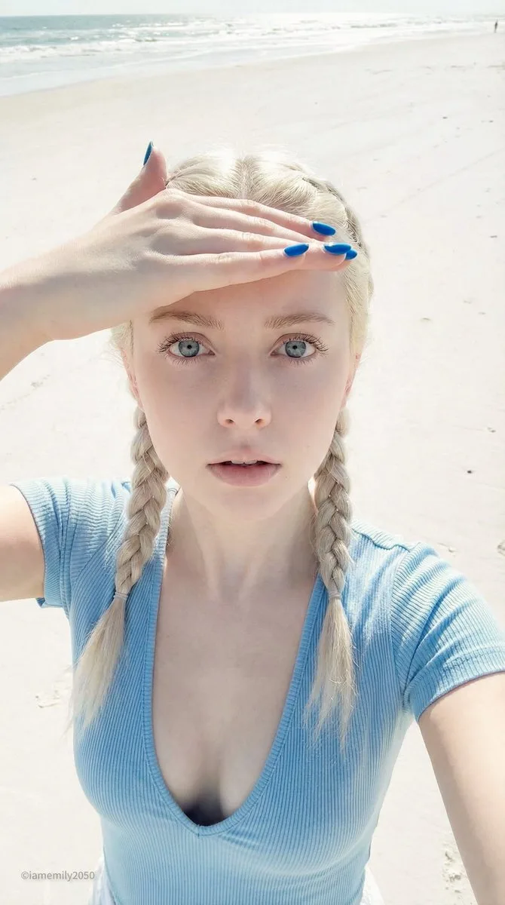

# Emily — by @IamEmily2050

[← Back to Community Examples](../../EXAMPLES.md) · Category: Photography · Model: `Nano Banana`

<a href="https://x.com/IamEmily2050/status/2013189624848633963"></a>

Source: **[@IamEmily2050 on X](https://x.com/IamEmily2050/status/2013189624848633963)** · Creator: [Emily](https://x.com/IamEmily2050)

## Prompt

```text
{
    "format": {
      "type": "editorial",
      "intent": "candid/selfie/accidental",
      "aspect_ratio": "9:16",
      "resolution": "4K"
    },
    "camera_system": {
      "body": "iPhone 15 Pro",
      "lens": "Main Camera",
      "focal_length": "24mm",
      "associative_traits": "computational photography, deep depth of field, sharp digital readout, auto-exposure"
    },
    "subject": {
      "identity": "young woman with specific porcelain doll features",
      "physical_details": "flawless pale skin, large round icy blue eyes with defined lashes, small defined nose, pouty neutral mouth, platinum blonde hair in two tight braids, vibrant blue manicured nails",
      "clothing": "light blue form-fitting top with a very deep, wide plunging V-neckline revealing significant cleavage",
      "action": "high-angle selfie POV, shielding eyes with one hand against bright coastal light, looking up at camera",
      "expression": "neutral, wide-eyed, deadpan, vacant doll-like stare"
    },
    "lighting": {
      "source": "bright natural coastal daylight + sand bounce",
      "direction": "overhead and omnidirectional fill",
      "quality": "soft, diffused but very bright",
      "color_temp": "neutral daylight (5500K)",
      "fill": "maximum fill from bright white sand reflection",
      "distribution": "even illumination, few shadows, flattering on skin texture",
      "intent": "bright beach day"
    },
    "environment": {
      "setting": "sandy beach during the day",
      "hero_materials": [
        {
          "material": "sand",
          "micro_detail": "fine white grains, highly reflective"
        },
        {
          "material": "fabric",
          "micro_detail": "light blue swimwear/stretch cotton blend"
        },
        {
          "material": "skin",
          "micro_detail": "smooth, poreless, porcelain texture, slightly dewy from heat"
        }
      ],
      "objects": "ocean horizon line blurred in far background, expansive sand",
      "state": "bright, sunny, coastal"
    },
    "technical_finish": {
      "film_stock": "Digital Source",
      "exposure": "brightly exposed (high key)",
      "grain": "none/digital noise",
      "tone_curve": "linear neutral",
      "color_science": "pastel palette (light blues, white sand, pale skin), natural daylight colors"
    },
    "constraints": {
      "avoid": [
        "snow",
        "winter clothes",
        "red nails",
        "black top",
        "modest neckline",
        "heavy shadows"
      ],
      "must_include": [
        "blue nails",
        "light blue top",
        "deep cleavage",
        "beach background",
        "porcelain doll features"
      ]
    }
  }
}
```

## Try it

Paste the prompt into **[vinano.ai](https://vinano.ai?utm_source=github&utm_medium=readme&utm_campaign=awesome-image-video-prompts-updating&utm_content=x-page-try)** to generate your own version.

> The image and prompt belong to @IamEmily2050 ([original post](https://x.com/IamEmily2050/status/2013189624848633963)) and are shown here with credit for reference. Creators can ask for changes or removal by opening an issue.
