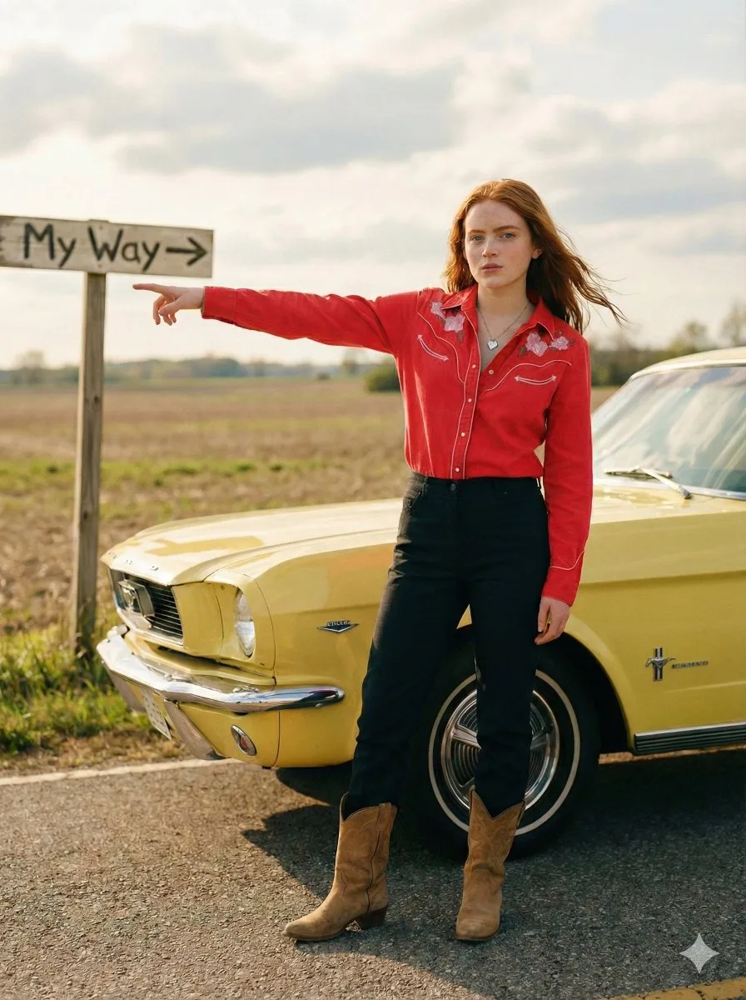

# ANKIT PATEL 🇮🇳 | AI — by @Ankit_patel211

[← Back to Community Examples](../../EXAMPLES.md) · Category: Photography · Model: `Nano Banana`

<a href="https://x.com/Ankit_patel211/status/2011729938991497671"></a>

Source: **[@Ankit_patel211 on X](https://x.com/Ankit_patel211/status/2011729938991497671)** · Creator: [ANKIT PATEL 🇮🇳 | AI](https://x.com/Ankit_patel211)

## Prompt

```text
{
  "project": "Nano Banana – Maximalist Editorial Americana Scene",
  "version": "2.4",
  "engine_optimization": "Nano Banana (maximalist cinematic photorealism, high detail density, controlled imperfection)",
  "render_intent": "cohesive western color harmony with refined fashion detail and narrative clarity",
  "frame": {
    "aspect_ratio": "3:4",
    "shot_type": "medium-full portrait",
    "camera_angle": "eye-level with subtle cinematic parallax",
    "composition": "subject foreground dominant, pointing gesture aligned parallel to the sign, car balancing the frame",
    "lens_simulation": "50mm full-frame prime",
    "camera_metadata": {
      "iso": 100,
      "shutter_speed": "1/320",
      "aperture": "f/1.8"
    },
    "depth_of_field": "shallow, face and guiding hand crisp, background softly diffused"
  },
  "subject": {
    "type": "young woman",
    "approximate_age": "early to mid 20s",
    "identity_consistency": "single subject, realistic anatomy, natural proportions",
    "appearance": {
      "hair": {
        "color": "deep brunette",
        "length": "long",
        "style": "loose, softly flowing, gently wind-swept"
      },
      "face": {
        "beauty_level": "very beautiful, striking yet natural",
        "pose_detail": "face slightly tilted, enhancing elegance and approachability"
      },
      "skin": {
        "tone": "light to medium",
        "details": [
          "natural texture",
          "subtle freckles",
          "soft daylight glow"
        ]
      },
      "eyes": {
        "color": "warm brown or hazel",
        "expression": "inviting, confident, gently persuasive"
      },
      "makeup": "minimal, clean editorial finish"
    },
    "expression": "calm confidence with a subtle, encouraging smile",
    "pose": "standing beside the car, torso slightly angled, arm extended horizontally, pointing parallel to the sign as if signaling ‘follow that way, follow me’"
  },
  "wardrobe": {
    "top": "light pastel blue denim shirt with visible weave, pink and white embroidery in refined western motifs",
    "fit": "relaxed yet tailored",
    "bottom": "light brown pants, soft twill or suede-like texture, tailored with natural creases",
    "footwear": "warm tan suede cowboy boots, medium contrast, elegant western stitching, slightly worn for authenticity",
    "accessories": [
      "silver necklace",
      "small silver heart-shaped pendant, delicate and understated, resting just below the collarbone"
    ],
    "fabric_behavior": "authentic material stiffness and drape, embroidered threads catching light, natural folds and tension"
  },
  "vehicle": {
    "type": "classic Ford Mustang",
    "color": "lemon yellow",
    "finish": "glossy paint with realistic reflections and subtle surface imperfections",
    "positioning": "parked beside the subject at a slight diagonal, iconic profile visible"
  },
  "environment": {
    "location": "open roadside or rural edge",
    "background_elements": [
      "roadside sign with clearly legible text: 'My Way'",
      "open sky",
      "soft greenery or distant fields"
    ],
    "atmosphere": "freedom, direction, invitation, optimistic Americana mood"
  },
  "lighting": {
    "type": "natural daylight",
    "source": "open sky sunlight",
    "time_of_day": "late afternoon",
    "quality": "soft, directional, cinematic",
    "effects": [
      "gentle rim light on hair and shoulders",
      "subtle highlights on silver jewelry",
      "soft reflections on car paint"
    ],
    "shadow_behavior": "clean, soft-edged, physically accurate"
  },
  "color_palette": {
    "dominant_colors": [
      "lemon yellow",
      "pastel denim blue",
      "light brown",
      "warm tan",
      "soft pink and white embroidery",
      "natural skin tones",
      "silver accents"
    ],
    "grading_style": "warm cinematic editorial grading with filmic highlight roll-off"
  }
}
```

## Try it

Paste the prompt into **[vinano.ai](https://vinano.ai?utm_source=github&utm_medium=readme&utm_campaign=awesome-image-video-prompts-updating&utm_content=x-page-try)** to generate your own version.

> The image and prompt belong to @Ankit_patel211 ([original post](https://x.com/Ankit_patel211/status/2011729938991497671)) and are shown here with credit for reference. Creators can ask for changes or removal by opening an issue.
