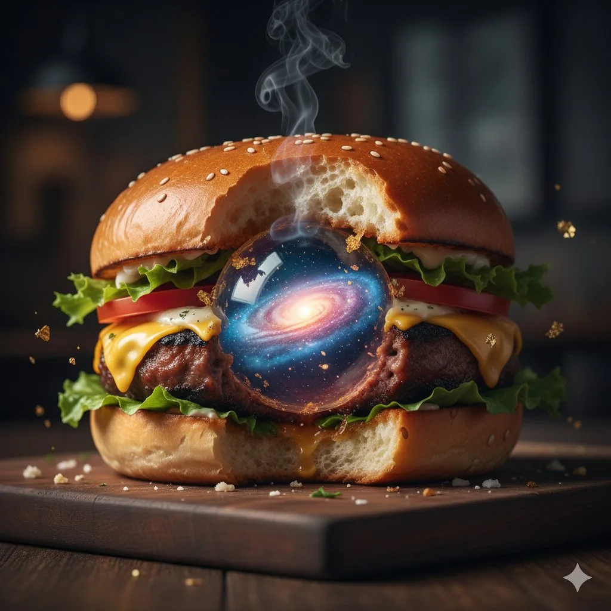

# Cuties — by @cuties7377

[← Back to Community Examples](../../EXAMPLES.md) · Category: Food & Drink · Model: `Nano Banana`

<a href="https://x.com/cuties7377/status/2011374713780457546"></a>

Source: **[@cuties7377 on X](https://x.com/cuties7377/status/2011374713780457546)** · Creator: [Cuties](https://x.com/cuties7377)

## Prompt

```text
{
  "content_goal": "viral food visual with extreme craving appeal",
  "image_type": "ultra-photorealistic food action photography",
  "visual_style": {
    "aesthetic": "cinematic food editorial, hyper-real",
    "vibe": "juicy, indulgent, irresistible",
    "realism": "high-end commercial food realism"
  },
  "composition": {
    "framing": "tight close-up or medium close-up",
    "camera_angle": "slightly low or front-facing",
    "subject_position": "centered hero bite moment",
    "perspective": "depth-rich with strong foreground focus"
  },
  "subject": {
    "description": "large gourmet burger captured mid-bite",
    "bite_action": "visible bite mark with compressed layers",
    "ingredients": "juicy beef patty, melted cheese, fresh lettuce, tomato, sauce drip",
    "details": "cheese stretch, sauce gloss, steam rising"
  },
  "texture_details": {
    "bun": "soft toasted bun with sesame seeds",
    "patty": "juicy with visible meat fibers",
    "cheese": "melted, glossy, stretching",
    "sauce": "thick, dripping naturally"
  },
  "human_element": {
    "hands": "realistic hands holding burger",
    "bite_mark": "natural teeth impression",
    "skin_detail": "natural skin texture, clean nails"
  },
  "lighting": {
    "type": "dramatic food lighting",
    "quality": "warm, directional, high-contrast",
    "direction": "side or top-side light emphasizing gloss",
    "highlight_focus": "cheese melt and sauce texture",
    "shadow_style": "deep but controlled shadows"
  },
  "color_palette": {
    "primary": ["golden brown", "cheese yellow", "deep red"],
    "accent": ["lettuce green"],
    "mood": "rich, bold, indulgent"
  },
  "environment": {
    "location": "burger joint, café, or studio food setup",
    "background": "dark, blurred background to isolate burger",
    "atmosphere": "warm, indulgent, street-food luxury"
  },
  "camera_details": {
    "camera_type": "professional DSLR / mirrorless simulation",
    "lens": "85mm or macro food lens",
    "focus": "tack-sharp on bite area",
    "depth_of_field": "shallow for dramatic bokeh",
    "resolution": "advertising-grade clarity"
  },
  "quality_control": {
    "food_realism": "hyper-real textures, no plastic look",
    "bite_accuracy": "natural compression of ingredients",
    "ai_artifacts": "none",
    "professional_finish": "commercial food photography quality"
  },
  "overall_mood": "mouth-watering, bold, indulgent",
  "intended_use": {
    "primary": "viral food post on X",
    "secondary": "restaurant branding, food editorial, ads"
  }
}
```

## Try it

Paste the prompt into **[vinano.ai](https://vinano.ai?utm_source=github&utm_medium=readme&utm_campaign=awesome-image-video-prompts-updating&utm_content=x-page-try)** to generate your own version.

> The image and prompt belong to @cuties7377 ([original post](https://x.com/cuties7377/status/2011374713780457546)) and are shown here with credit for reference. Creators can ask for changes or removal by opening an issue.
