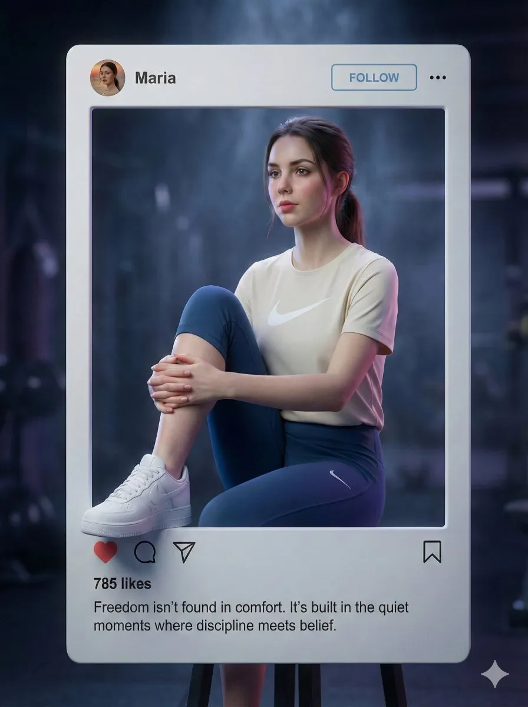

# Abhishek Singh — by @2abhisheknaks

[← Back to Examples from X](../../EXAMPLES.md) · Category: Illustration & 3D · Model: `Nano Banana`

<a href="https://x.com/2abhisheknaks/status/2016154222765527482"></a>

Original post: **[@2abhisheknaks on X](https://x.com/2abhisheknaks/status/2016154222765527482)** · Creator: [Abhishek Singh](https://x.com/2abhisheknaks)

## Prompt

```text
{
  "image_generation_prompt": {
    "subject": {
      "description": "A photorealistic young woman with brown hair tied back in a ponytail, sitting on a stool.",
      "pose": "Sitting with one knee raised, hands clasped around her shin, looking slightly to the side with a calm, focused expression.",
      "clothing": {
        "top": "Beige t-shirt with a white Nike swoosh logo on the chest.",
        "bottoms": "Dark blue leggings with a small white swoosh logo on the thigh.",
        "footwear": "White athletic sneakers."
      }
    },
    "composition": {
      "foreground_element": "A large, 3D-rendered white social media frame resembling an Instagram post, physically framing the subject.",
      "ui_details": {
        "header": {
          "profile_picture": "Profile picture of the woman",
          "username": "Maria",
          "follow_button": {
            "text": "FOLLOW",
            "color": "Blue"
          }
        },
        "footer_icons": [
          {
            "type": "like",
            "icon": "Heart",
            "color": "Red",
            "state": "Liked"
          },
          {
            "type": "comment",
            "icon": "Comment bubble"
          },
          {
            "type": "share",
            "icon": "Paper plane"
          },
          {
            "type": "bookmark",
            "icon": "Bookmark"
          }
        ],
        "likes_count": 785,
        "caption": "Freedom isn’t found in comfort. It’s built in the quiet moments where discipline meets belief."
      }
    },
    "environment": {
      "setting": "A dimly lit, atmospheric gym background.",
      "details": "Blurred gym equipment in the shadows, creating a strong depth of field."
    },
    "style": {
      "visual_style": "3D realistic render using Unreal Engine 5, cinematic and high fidelity.",
      "lighting": {
        "subject": "Soft spotlight focused on the woman",
        "background": "Cool ambient lighting with subtle shadows"
      }
    }
  }
}
```

## Try it

Paste the prompt into **[vinano.ai](https://vinano.ai?utm_source=github&utm_medium=readme&utm_campaign=awesome-image-video-prompts-updating&utm_content=x-page-try)** to generate your own version.

> The image and prompt belong to [@2abhisheknaks](https://x.com/2abhisheknaks) and are shown here with credit for reference. Creators can ask for changes or removal by opening an issue.
