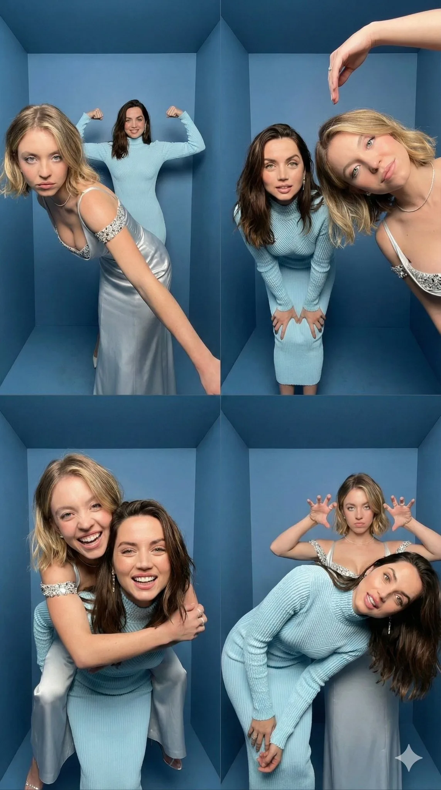

# Sudee🥀 — by @NameIsSudee

[← Back to Examples from X](../../EXAMPLES.md) · Category: Photography · Model: `Nano Banana`

<a href="https://x.com/NameIsSudee/status/2008809931550716249"></a>

Original post: **[@NameIsSudee on X](https://x.com/NameIsSudee/status/2008809931550716249)** · Creator: [Sudee🥀](https://x.com/NameIsSudee)

## Prompt

```text
{
  "task": "Create an iPhone-realistic photobooth collage (4 photos in a 2x2 grid)",
  "subjects": [
    {
      "id": "Subject 1",
      "description": "EXACTLY from the Reference Image (same face, hairstyle, skin tone, body proportions, overall look).",
      "outfit": "EXACTLY the same as in the Reference Image. Do not change clothing, glasses, or accessories."
    },
    {
      "id": "Subject 2",
      "description": "EXACTLY from the Reference Image (same face, hairstyle, skin tone, body proportions, overall look).",
      "outfit": "EXACTLY the same as in the Reference Image. Do not change clothing, glasses, or accessories."
    }
  ],
  "scene": {
    "location": "Inside a small BOX photo booth",
    "background": "Matte blue walls and blue floor, tight enclosed corner, clean minimal environment",
    "camera_look": "Ultra wide / slight fisheye lens look with subtle perspective distortion typical of photobox cameras. iPhone 17 Pro, photobooth wide-angle.",
    "lighting": "Bright neutral-white flash lighting, evenly illuminating faces, soft shadow falloff on blue walls, crisp detail, realistic skin texture. Direct neutral white flash (no yellow / no warm tone).",
    "aesthetic": "4K, amateur photobooth aesthetic, high contrast but still natural, no cinematic grading, no heavy beauty filter, no blur, no text, no watermark."
  },
  "layout": {
    "type": "2x2 grid collage",
    "aspect_ratio": "9:16 (vertical collage)",
    "style": "Clean, with NO white borders, NO frame lines, NO gaps, and NO outlines between photos (seamless collage). Each frame fills its quadrant edge-to-edge."
  },
  "frames": [
    {
      "position": "top-left",
      "content": "Subject 1 leans diagonally toward the camera from the front-left, one arm stretched down, playful serious face; Subject 2 stands behind in the center, arms raised and flexing like “strongman”, smiling."
    },
    {
      "position": "top-right",
      "content": "Subject 2 leans forward toward the camera, hands on knees, curious expression; Subject 1 enters from the right side very close to camera, tilting her head, one arm arched above her head like a half-heart pose, soft smile."
    },
    {
      "position": "bottom-left",
      "content": "Piggyback pose — Subject 1 on Subject 2’s back, arms wrapped around shoulders; both laughing big, faces close to camera, dynamic motion vibe."
    },
    {
      "position": "bottom-right",
      "content": "Subject 2 bends sideways/leans forward with a goofy face; Subject 1 stands behind making playful “claw/horns” hand gestures above Subject 2’s head, slightly pouting for fun."
    }
  ]
}
```

## Try it

Paste the prompt into **[vinano.ai](https://vinano.ai?utm_source=github&utm_medium=readme&utm_campaign=awesome-image-video-prompts-updating&utm_content=x-page-try)** to generate your own version.

> The image and prompt belong to [@NameIsSudee](https://x.com/NameIsSudee) and are shown here with credit for reference. Creators can ask for changes or removal by opening an issue.
