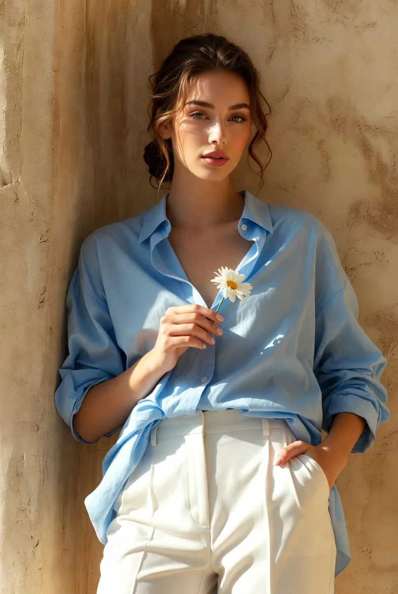

# Aarvi sharma — by @me_Aarvi

[← Back to Examples from X](../../EXAMPLES.md) · Category: Photography · Model: `Nano Banana`

<a href="https://x.com/me_Aarvi/status/2011444759605510287"></a>

Original post: **[@me_Aarvi on X](https://x.com/me_Aarvi/status/2011444759605510287)** · Creator: [Aarvi sharma](https://x.com/me_Aarvi)

## Prompt

```text
Using the uploaded reference image STRICTLY, preserve the same woman’s face, identity, age, facial structure, skin tone, and natural expression with 100% accuracy. No facial alteration, beautification, or identity change.\n\nGenerate a highly realistic cinematic fashion editorial photoshoot featuring a stylish adult woman leaning casually against a warm beige textured wall. Her body is slightly angled, one shoulder gently resting on the wall, conveying relaxed confidence, elegance, and quiet strength.\n\nOutfit:\nShe wears a loose pastel blue button-down shirt with softly rolled-up sleeves, styled effortlessly. Paired with tailored white relaxed-fit trousers that drape naturally. Footwear consists of clean minimalist white or soft blue-white sneakers, maintaining a modern, understated luxury feel.\n\nPose & Expression:\nShe stands with natural posture — one hand casually placed in her trouser pocket, the other delicately holding a small white daisy flower. Her facial expression is calm, self-assured, and serene, with a soft editorial gaze slightly away from the camera. Emotion feels confident yet gentle.\n\nHair & Makeup:\nHair is neatly styled in a natural, modern look (soft waves, low ponytail, or loose bun). Makeup is minimal and refined — clean skin, subtle blush, neutral lips, no heavy contouring or glow.\n\nLighting & Atmosphere:\nWarm natural sunlight streams from the side, creating soft highlights along her face and clothing, with gentle shadows adding depth to the textured wall. The mood is airy, sunlit, and cinematic.\n\nVisual Style:\nHigh-end fashion editorial aesthetic with realistic skin texture, crisp fabric details, refined neutral color palette, and elegant composition.\n\nCamera & Quality:\nProfessional fashion photography style, shallow depth of field, cinematic framing, ultra-realistic 8K quality, sharp focus on subject with smooth background falloff.\n\nOverall Feel:\nModern, minimal, sun-drenched lifestyle fashion campaign — confident, graceful, and timeless.",
  
  "style": "cinematic, high-end female fashion editorial",
  "lighting": "warm natural sunlight with soft shadows",
  "background": "minimal beige textured wall, sunlit",
  "quality": "ultra-realistic, 8K, ultra-sharp",
  "camera": "professional fashion photography, shallow depth of field",
  "mood": "clean, modern, elegant, confident, relaxed"
```

## Try it

Paste the prompt into **[vinano.ai](https://vinano.ai?utm_source=github&utm_medium=readme&utm_campaign=awesome-image-video-prompts-updating&utm_content=x-page-try)** to generate your own version.

> The image and prompt belong to [@me_Aarvi](https://x.com/me_Aarvi) and are shown here with credit for reference. Creators can ask for changes or removal by opening an issue.
