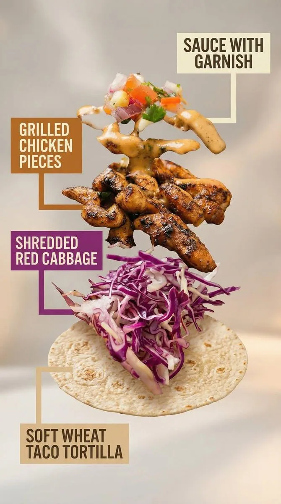

# 𝐌 — by @Strength04_X

[← Back to Examples from X](../../EXAMPLES.md) · Category: Food & Drink · Model: `Nano Banana`

<a href="https://x.com/Strength04_X/status/2011770206839062641"></a>

Original post: **[@Strength04_X on X](https://x.com/Strength04_X/status/2011770206839062641)** · Creator: [𝐌](https://x.com/Strength04_X)

## Prompt

```text
A high-end commercial food photograph of the same two tacos from the reference image, preserving their exact structure, fillings, proportions, and arrangement. The camera angle is slightly adjusted to a more flattering three-quarter close-up, enhancing depth and appetite appeal without altering the tacos themselves. Soft cinematic lighting highlights the textures of the tortillas and fillings, with subtle steam and natural sheen to emphasize freshness. The background is replaced with a clean, modern, out-of-focus setting in warm complementary tones that enhance the food without distracting from it. Shallow depth of field, crisp focus on the tacos, rich contrast, natural colors, and premium restaurant advertising quality. No added or removed ingredients, refined composition, lighting, and environment.

Image 2: Exploded-view commercial visualization of the taco from the image, presented as premium recipe-style breakdown.

The taco is deconstructed into four visible ingredients, matching the original taco precisely in composition, color, and texture. No additional ingredients.

The ingredients are separated and arranged in a clean vertical stack, evenly spaced from bottom to top, floating in place with precise alignment and symmetry.

Ingredient order (bottom → top):

Soft wheat taco tortilla

Shredded red cabbage

Grilled chicken pieces

Sauce with garnish (topped with a small mixed garnish of diced onion, tomato, and parsley, approximately 5–6 small cubes total, lightly mixed, placed naturally on top)

Each ingredient is visually distinct and clearly readable in shape and texture.

Annotation design requirements:

– Large, bold sans-serif font, high legibility at feed scale

– Each annotation placed inside a solid or softly rounded rectangular color block

– Background color of each block corresponds subtly to the ingredient color (tomato red, lettuce green, meat warm brown, sauce white/cream, pita beige)

– High contrast text (dark on light, light on dark)

– Thick, clean connector lines pointing clearly to each ingredient

– No transparency that reduces readability

– Annotations must visually dominate over background without covering ingredients

Background is soft, neutral, and atmospheric, with subtle depth and gentle gradients, inspired by premium food advertising.

Overall style is clean, modern, and appetizing, commercial-ready without technical or schematic feel.

No extra elements, no substitutions, no reinterpretation of ingredients.
```

## Try it

Paste the prompt into **[vinano.ai](https://vinano.ai?utm_source=github&utm_medium=readme&utm_campaign=awesome-image-video-prompts-updating&utm_content=x-page-try)** to generate your own version.

> The image and prompt belong to [@Strength04_X](https://x.com/Strength04_X) and are shown here with credit for reference. Creators can ask for changes or removal by opening an issue.
