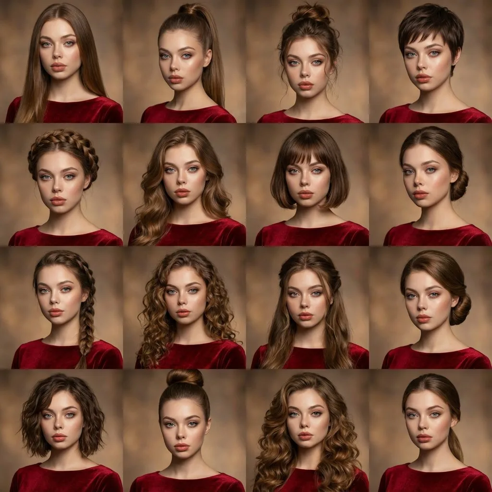

# Synthia — by @AIwithSynthia

[← Back to Community Examples](../../EXAMPLES.md) · Category: Photography · Model: `Nano Banana`

<a href="https://x.com/AIwithSynthia/status/2013225585297043665"></a>

Source: **[@AIwithSynthia on X](https://x.com/AIwithSynthia/status/2013225585297043665)** · Creator: [Synthia](https://x.com/AIwithSynthia)

## Prompt

```text
A high-quality photo collage featuring the same person with identical facial features and expression, shown in multiple frames with different hairstyles. Each panel displays a unique hairstyle such as long straight hair, high ponytail, messy bun, pixie cut, braided crown, soft waves, short bob with bangs, low bun, side braid, and loose curls. Consistent neutral outfit and makeup across all images, soft studio lighting, warm blurred background, realistic skin texture, symmetrical face consistency, ultra-detailed, editorial beauty look, 4x3 grid layout, professional portrait photograph
```

## Try it

Paste the prompt into **[vinano.ai](https://vinano.ai?utm_source=github&utm_medium=readme&utm_campaign=awesome-image-video-prompts-updating&utm_content=x-page-try)** to generate your own version.

> The image and prompt belong to @AIwithSynthia ([original post](https://x.com/AIwithSynthia/status/2013225585297043665)) and are shown here with credit for reference. Creators can ask for changes or removal by opening an issue.
