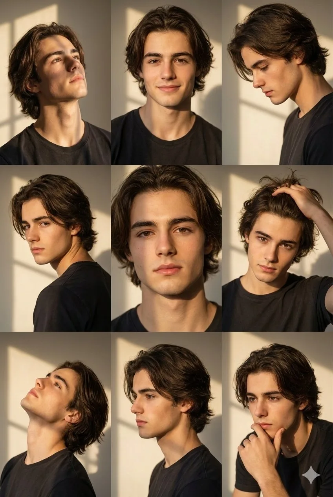

# Harboriis — by @harboriis

[← Back to Examples from X](../../EXAMPLES.md) · Category: Photography · Model: `Nano Banana`

<a href="https://x.com/harboriis/status/2008484790287430022"></a>

Original post: **[@harboriis on X](https://x.com/harboriis/status/2008484790287430022)** · Creator: [Harboriis](https://x.com/harboriis)

## Prompt

```text
{
  "image_generation": {
    "face": {
      "preserve_original": true,
      "reference_match": true,
      "description": "Maintain the same facial structure, skin tone, eye shape, and natural expressions across all frames, with consistent identity in each pose."
    },
    "photo_style": {
      "type": "golden hour portrait collage",
      "camera_angle": "varied close-up and medium portrait angles",
      "lighting": "warm golden hour sunlight casting soft window shadows",
      "mood": "soft, calm, intimate, aesthetic",
      "texture": "natural skin texture, soft highlights, gentle contrast",
      "focus": "sharp focus on face with smooth background falloff"
    },
    "subject": {
      "gender": "male",
      "age": "young adult",
      "poses": [
        "looking upward toward light",
        "soft smile facing camera",
        "side profile with downward gaze",
        "over-the-shoulder glance",
        "direct close-up with relaxed lips",
        "hand in hair casual pose",
        "head tilted back toward light",
        "clean side profile portrait",
        "thoughtful pose with hand near chin"
      ],
      "expression": "natural, minimal, relaxed, emotionally subtle",
      "hair": {
        "style": "long straight hair worn loose",
        "color": "light to medium brown",
        "details": "natural shine with soft light highlights"
      },
      "clothing": {
        "type": "casual minimalist outfit",
        "details": "simple dark t-shirt with no visible branding"
      }
    },
    "composition": {
      "layout": "3x3 grid collage",
      "consistency": "uniform lighting and background across all frames",
      "framing": "clean portrait framing with slight pose variation"
    },
    "environment": {
      "setting": "indoor space near a window",
      "background": "plain wall with warm sunlight and shadow patterns",
      "atmosphere": "quiet, minimal, artistic indoor ambiance"
    },
    "aesthetic": {
      "style": "Instagram aesthetic portrait set",
      "features": [
        "golden hour light",
        "window shadow patterns",
        "minimal makeup",
        "natural expressions",
        "clean editorial portrait look"
      ]
    }
  }
}
```

## Try it

Paste the prompt into **[vinano.ai](https://vinano.ai?utm_source=github&utm_medium=readme&utm_campaign=awesome-image-video-prompts-updating&utm_content=x-page-try)** to generate your own version.

> The image and prompt belong to [@harboriis](https://x.com/harboriis) and are shown here with credit for reference. Creators can ask for changes or removal by opening an issue.
