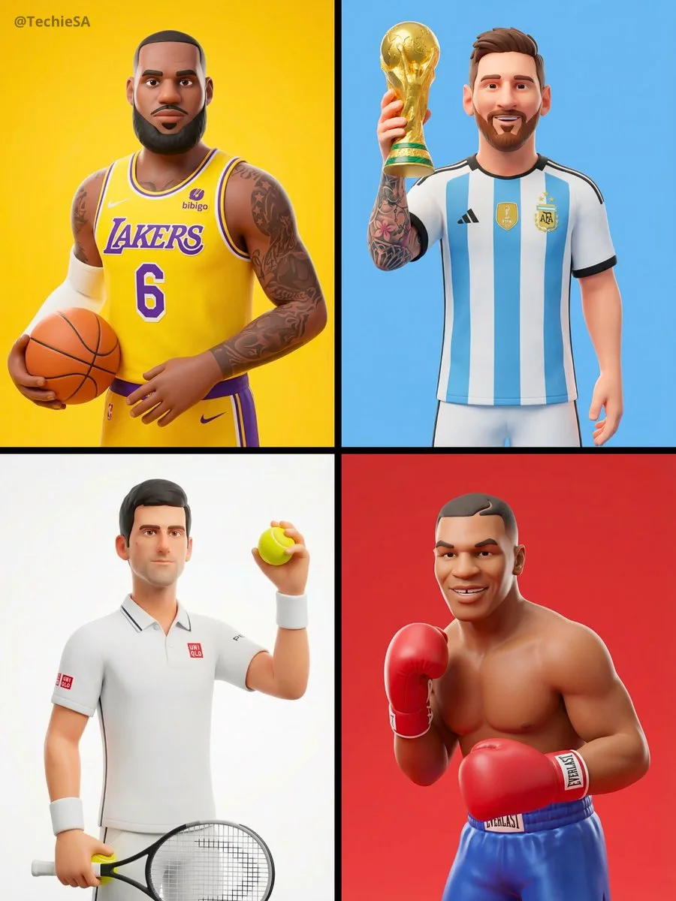

# TechieSA — by @TechieBySA

[← Back to Community Examples](../../EXAMPLES.md) · Category: Illustration & 3D · Model: `Nano Banana`

<a href="https://x.com/TechieBySA/status/2020837883549298730"></a>

Source: **[@TechieBySA on X](https://x.com/TechieBySA/status/2020837883549298730)** · Creator: [TechieSA](https://x.com/TechieBySA)

## Prompt

```text
Use a user-uploaded image as the source and convert the person into a stylized 3D character while preserving identity, facial structure, pose, hairstyle, clothing, and overall composition exactly as shown in the photo. The result should clearly resemble the real person.

The visual style is a stylized 3D character with a soft minimal cartoon 3D aesthetic, inspired by Pixar-like visuals but more minimal, toy-figure renders, and clean product-style character design. The balance should favor stylization over realism without changing the person’s real-world appearance.

Skin should appear as smooth matte plastic with a soft, uniform texture and gentle subsurface scattering. Facial features should remain faithful to the original image while being simplified in form. The expression should stay neutral and natural to the source photo.

Lighting should be clean and controlled, similar to a studio softbox setup, with very soft shadows, low contrast, and subtle highlights. The background should be a solid [BACKGROUND COLOR] with no gradient.

The camera should feel front-facing with a medium close-up framing, similar to a 50mm lens, with no distortion. Output quality should be high resolution with clean edges, no noise, strong style consistency, and a clearly non-photorealistic finish.
```

## Try it

Paste the prompt into **[vinano.ai](https://vinano.ai?utm_source=github&utm_medium=readme&utm_campaign=awesome-image-video-prompts-updating&utm_content=x-page-try)** to generate your own version.

> The image and prompt belong to @TechieBySA ([original post](https://x.com/TechieBySA/status/2020837883549298730)) and are shown here with credit for reference. Creators can ask for changes or removal by opening an issue.
