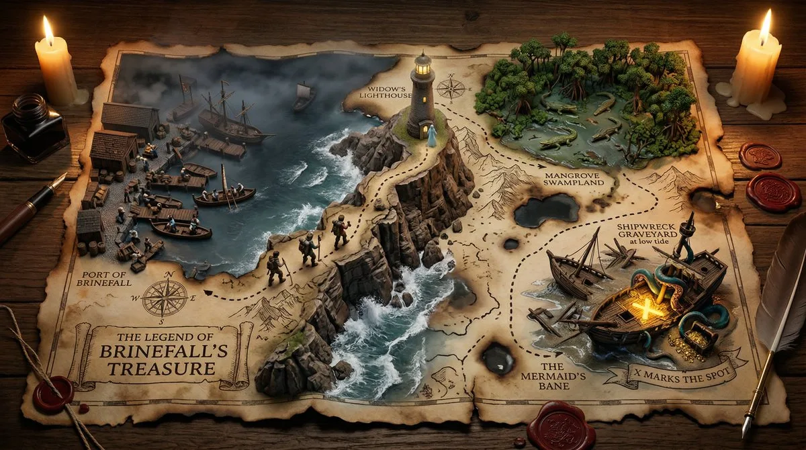

# Alexandra Aisling — by @AllaAisling

[← Back to Community Examples](../../EXAMPLES.md) · Category: Illustration & 3D · Model: `Nano Banana`

<a href="https://x.com/AllaAisling/status/2027140622252179959"></a>

Source: **[@AllaAisling on X](https://x.com/AllaAisling/status/2027140622252179959)** · Creator: [Alexandra Aisling](https://x.com/AllaAisling)

## Prompt

```text
A hand-drawn treasure map on aged parchment, with the adventure erupting into three-dimensional quest. {STARTING_POINT} rises at the map's edge with {DEPARTURE_SCENE}, the dotted path becomes an actual trail traversing {TERRAIN_1} with {DANGER_1}, passing {LANDMARK_1} where {OBSTACLE_1} awaits. {TERRAIN_2} features {WILDLIFE_1} and {ENVIRONMENTAL_HAZARD}. The X marking the spot glows beneath {FINAL_LOCATION}, treasure partially visible, {GUARDIAN_ELEMENT} protecting it. Miniature expedition party frozen mid-journey at various points along the route. Torn edges of the map become cliffs. Coffee stains become lakes. Burn marks become scorched earth from battles past. Candlelight flicker, adventure novel lighting, 8K, the map as the story it promises.
```

## Try it

Paste the prompt into **[vinano.ai](https://vinano.ai?utm_source=github&utm_medium=readme&utm_campaign=awesome-image-video-prompts-updating&utm_content=x-page-try)** to generate your own version.

> The image and prompt belong to @AllaAisling ([original post](https://x.com/AllaAisling/status/2027140622252179959)) and are shown here with credit for reference. Creators can ask for changes or removal by opening an issue.
