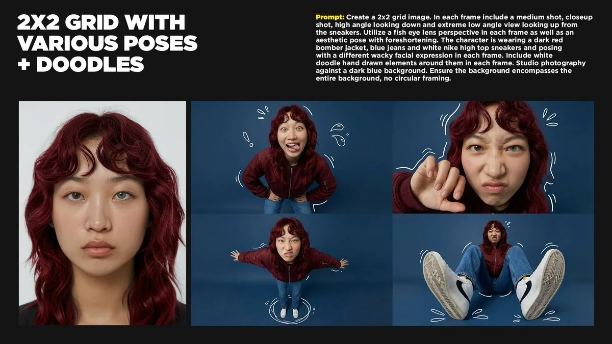

# Travis Davids — by @MrDavids1

[← Back to Examples from X](../../EXAMPLES.md) · Category: Photography · Model: `Nano Banana`

<a href="https://x.com/MrDavids1/status/2012224276900851827"></a>

Original post: **[@MrDavids1 on X](https://x.com/MrDavids1/status/2012224276900851827)** · Creator: [Travis Davids](https://x.com/MrDavids1)

## Prompt

```text
Create a 2x2 grid image. In each frame include a medium shot, closeup shot, high angle looking down and extreme low angle view looking up from the sneakers. Utilize a fish eye lens perspective in each frame as well as an aesthetic pose with foreshortening. The character is wearing a dark red bomber jacket, blue jeans and white nike high top sneakers and posing with a different wacky facial expression in each frame. Include white doodle hand drawn elements around them in each frame. Studio photography against a dark blue background. Ensure the background encompasses the entire background, no circular framing.
```

## Try it

Paste the prompt into **[vinano.ai](https://vinano.ai?utm_source=github&utm_medium=readme&utm_campaign=awesome-image-video-prompts-updating&utm_content=x-page-try)** to generate your own version.

> The image and prompt belong to [@MrDavids1](https://x.com/MrDavids1) and are shown here with credit for reference. Creators can ask for changes or removal by opening an issue.
