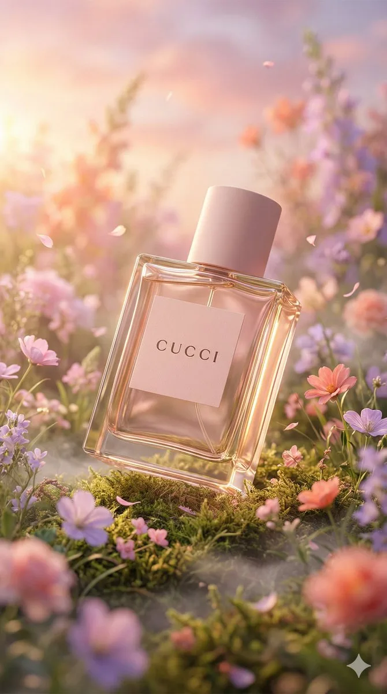

# Yaseen Khan Gul — by @YaseenK7212

[← Back to Examples from X](../../EXAMPLES.md) · Category: Product & Brand · Model: `Nano Banana`

<a href="https://x.com/YaseenK7212/status/2019404118486389234"></a>

Original post: **[@YaseenK7212 on X](https://x.com/YaseenK7212/status/2019404118486389234)** · Creator: [Yaseen Khan Gul](https://x.com/YaseenK7212)

## Prompt

```text
{
  "prompt": {
    "subject": "Hyper-realistic luxury perfume product photograph",
    "product": {
      "bottle": {
        "shape": "Rectangular",
        "material": "Transparent glass",
        "label": {
          "text": "CUCCI",
          "color": "Soft blush-pink",
          "texture": "Matte"
        },
        "cap": {
          "color": "Soft blush-pink",
          "texture": "Matte"
        },
        "placement": {
          "angle": "Gentle diagonal",
          "position": "Center"
        },
        "details": {
          "liquid": "Visible, with soft reflections",
          "highlights": "Glowing on glass edges"
        }
      }
    },
    "environment": {
      "setting": "Lush miniature fantasy meadow",
      "ground": "Moss-covered",
      "flora": {
        "flowers": ["Delicate pink", "Lavender", "Coral wildflowers"],
        "grasses": "Soft green"
      },
      "atmosphere": {
        "air": "Tiny petals drifting",
        "mist": "Faint, floating low"
      }
    },
    "lighting": {
      "source": "Warm golden-pink light from upper left",
      "effect": "Dreamy sunset",
      "type": "Studio-grade with subtle rim light"
    },
    "composition": {
      "depth_of_field": "Cinematic shallow",
      "focus": "Crisp on the brand name",
      "foreground": "Softly blurred blooms",
      "background": {
        "description": "Fading into a pastel bokeh haze",
        "elements": ["Florals", "Foliage"],
        "colors": ["Pink", "Peach", "Violet"]
      }
    },
    "style": {
      "aesthetic": "High-end editorial beauty",
      "mood": "Romantic and ethereal",
      "realism": "Premium realism",
      "quality": "8K",
      "textures": "Ultra-detailed (moss, petals, glass, label)"
    }
  }
}
```

## Try it

Paste the prompt into **[vinano.ai](https://vinano.ai?utm_source=github&utm_medium=readme&utm_campaign=awesome-image-video-prompts-updating&utm_content=x-page-try)** to generate your own version.

> The image and prompt belong to [@YaseenK7212](https://x.com/YaseenK7212) and are shown here with credit for reference. Creators can ask for changes or removal by opening an issue.
