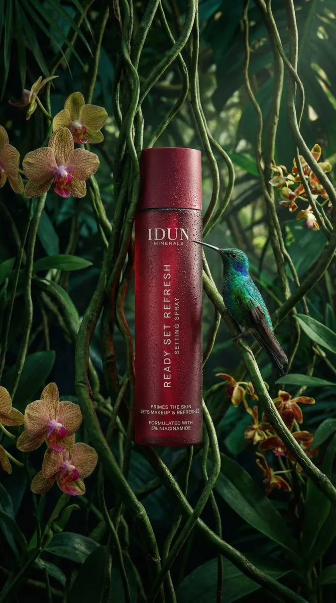

# Oogie — by @oggii_0

[← Back to Examples from X](../../EXAMPLES.md) · Category: Product & Brand · Model: `Nano Banana`

<a href="https://x.com/oggii_0/status/2020367995131105685"></a>

Original post: **[@oggii_0 on X](https://x.com/oggii_0/status/2020367995131105685)** · Creator: [Oogie](https://x.com/oggii_0)

## Prompt

```text
{
  "subject": {
    "primary": "Cosmetic spray bottle",
    "secondary": "Hummingbird",
    "brand": "IDUN MINERALS",
    "product_name": "READY SET REFRESH"
  },
  "packaging": {
    "form_factor": "Cylindrical bottle",
    "component_parts": [
      "Main body",
      "Cap (flush with body)"
    ],
    "material_appearance": "Matte finish, likely plastic or coated metal",
    "condition": "Pristine, new",
    "reflections": "Vertical highlight on the left side, mirrored reflection in water below"
  },
  "label_design": {
    "type": "Direct print onto bottle",
    "layout_orientation": "Mixed (Horizontal brand/details, Vertical product name)",
    "typography": {
      "font_family": "Sans-serif",
      "casing": "All uppercase",
      "style": "Clean, minimalist",
      "alignment": "Left aligned relative to the vertical axis for product name, centered horizontally for brand"
    }
  },
  "text_visible": {
    "brand_header": [
      "IDUN",
      "MINERALS"
    ],
    "body_vertical": [
      "READY SET REFRESH",
      "SETTING SPRAY"
    ],
    "footer_details": [
      "PRIMES THE SKIN",
      "SETS MAKEUP & REFRESHES",
      "FORMULATED WITH",
      "3% NIACINAMIDE"
    ],
    "reflection_text": "Inverted mirror image of all text visible on the water surface"
  },
  "colors": {
    "packaging_base": "Deep red / Burgundy",
    "text": "White",
    "foliage": [
      "Deep emerald green",
      "Forest green",
      "Moss green"
    ],
    "hummingbird": [
      "Iridescent green (head/back)",
      "Dark grey/brown (wings)",
      "Reddish/pink (tail feathers)",
      "Black (beak)"
    ],
    "water": "Dark, almost black with reflections"
  },
  "materials": {
    "bottle": "Matte rigid material",
    "environment": [
      "Liquid water",
      "Moss",
      "Fern leaves",
      "Palm-like leaves"
    ],
    "biological": "Feathers (bird)"
  },
  "human_elements": {
    "visible": false
  },
  "environment": {
    "setting": "Simulated rainforest or jungle floor",
    "foreground": "Still water surface",
    "midground": "Mossy bank, bottle placement",
    "background": "Dense tropical foliage"
  },
  "lighting": {
    "quality": "Soft, moody, atmospheric",
    "direction": "Side lighting from left (creating highlight on bottle)",
    "shadows": "Soft shadows in the foliage, dark water providing high contrast reflection",
    "highlights": "specular highlight on hummingbird head, diffuse highlight on bottle curve"
  },
  "camera": {
    "angle": "Eye-level with water surface",
    "framing": "Vertical portrait",
    "focus": "Sharp focus on bottle and hummingbird",
    "depth_of_field": "Shallow (background leaves are blurred/bokeh)",
    "composition": "Rule of thirds (bottle on left third line, bird entering from right)"
  },
  "style": {
    "category": "Product photography",
    "theme": "Nature, Organic, Eco-luxury",
    "mood": "Serene, fresh, premium"
  }
}
```

## Try it

Paste the prompt into **[vinano.ai](https://vinano.ai?utm_source=github&utm_medium=readme&utm_campaign=awesome-image-video-prompts-updating&utm_content=x-page-try)** to generate your own version.

> The image and prompt belong to [@oggii_0](https://x.com/oggii_0) and are shown here with credit for reference. Creators can ask for changes or removal by opening an issue.
