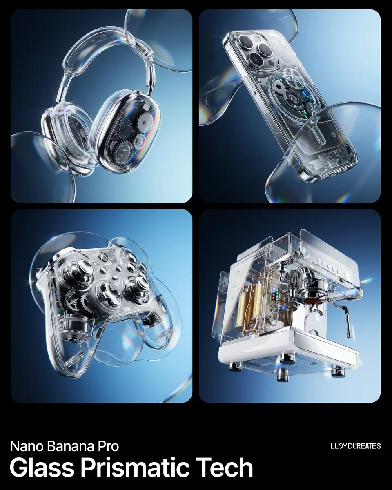

# Lloyd Creates — by @lloydcreates

[← Back to Examples from X](../../EXAMPLES.md) · Category: Illustration & 3D · Model: `Nano Banana`

<a href="https://x.com/lloydcreates/status/2019788303214776494"></a>

Original post: **[@lloydcreates on X](https://x.com/lloydcreates/status/2019788303214776494)** · Creator: [Lloyd Creates](https://x.com/lloydcreates)

## Prompt

```text
{
  "image_generation_request": {
    "subject": "[INSERT PRODUCT HERE]",
    "environment": {
      "background": "A smooth, professional dual-tone gradient transition between #111B24 and #CAEFFF",
      "lighting": "High-contrast studio lighting with bright rim highlights to emphasize glossy textures"
    },
    "style_elements": {
      "aesthetic": "Y2K Frutiger Aero meets modern hyper-realism",
      "optical_effects": [
        "Dynamic glass refraction",
        "Prismatic chromatic aberration at the edges of transparent objects",
        "Iridescent lens flares",
        "Distorted glass overlays floating in the foreground"
      ],
      "composition": "Floating, gravity-defying arrangement with a wide-angle perspective",
      "textures": "Polished chrome, transparent acrylic, and high-gloss plastic"
    },
    "technical_specs": {
      "resolution": "8k UHD",
      "render_engine": "Octane Render style",
      "detailing": "Macro photography focus, hyper-detailed mechanical parts"
    }
  }
}
```

## Try it

Paste the prompt into **[vinano.ai](https://vinano.ai?utm_source=github&utm_medium=readme&utm_campaign=awesome-image-video-prompts-updating&utm_content=x-page-try)** to generate your own version.

> The image and prompt belong to [@lloydcreates](https://x.com/lloydcreates) and are shown here with credit for reference. Creators can ask for changes or removal by opening an issue.
